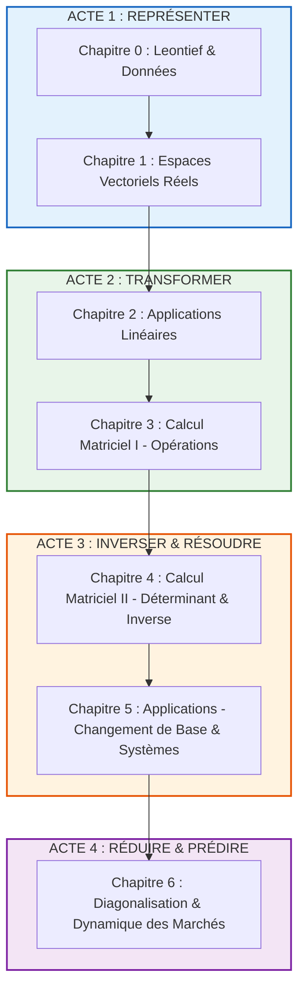

# 🧭 Guide Global & Sommaire du Cours d'Algèbre Linéaire
### *Algèbre linéaire et calcul matriciel — Programme Business Analyst (ICHEC)*
### *Professeur : M. Bui*

---

## 🌟 1. Bienvenue : La Grande Histoire de l'Algèbre Linéaire

Imagine que tu doives gérer un immense zoo ou un jeu vidéo comme *Minecraft*. 
- Chaque animal a besoin de nourriture, d'eau, d'espace et de soins.
- Chaque bloc a une position $(x, y, z)$, une couleur, un poids et une résistance.
- Si tu as **un seul** mouton et **une seule** variable (la quantité d'herbe), c'est une simple règle de trois que l'on apprend à l'école primaire.
- Mais si tu as **10 000 créatures**, **50 types de ressources** interconnectées et que chaque action sur une ressource impacte toutes les autres... ton cerveau humain ne peut plus tout suivre un par un !

C'est **exactement pour cela que l'algèbre linéaire a été inventée** !
L'algèbre linéaire est le **langage universel** qui permet de manipuler des milliers de variables en même temps, de les transformer d'un seul coup, et de trouver des solutions à des problèmes géants en quelques opérations simples et élégantes.

Pour un futur **Business Analyst** ou gestionnaire, c'est l'outil roi :
1. **Représenter** des données complexes (profils clients, coûts, paniers d'achat).
2. **Transformer** ces données pour créer des indicateurs prédictifs.
3. **Résoudre** des systèmes de contraintes (allocation de budgets, stocks, chaîne logistique).
4. **Anticiper l'avenir** (comment évoluent les parts de marché d'une entreprise dans 5, 10 ou 20 ans ?).

---

## 🗺️ 2. Le Fil Conducteur du Cours : Les 4 Grands Actes

Tout le cours est une progression logique parfaite en 4 étapes :

### Table de correspondance des Chapitres

| Chapitre | Fiche Complète | La Question Fondamentale (expliquée simplement) | Rôle dans la boîte à outils |
| :--- | :--- | :--- | :--- |
| **Chapitre 0** | [Fiche 0 : Introduction & Leontief](file:///c:/Users/cemmi/OneDrive%20-%20ICHEC/Math/Alg%C3%A8bre/Guides_de_Cours_Complets/Chapitre_0_Introduction_et_Modele_de_Leontief.md) | *"Pourquoi s'embêter avec des vecteurs et des matrices en gestion ?"* | Donne la vision d'ensemble avec le modèle d'entrée-sortie de Leontief. |
| **Chapitre 1** | [Fiche 1 : Espaces Vectoriels Réels](file:///c:/Users/cemmi/OneDrive%20-%20ICHEC/Math/Alg%C3%A8bre/Guides_de_Cours_Complets/Chapitre_1_Espaces_Vectoriels_Reels.md) | *"Où habitent nos données et comment construire des briques stables ?"* | Définit $\mathbb{R}^n$, les sous-espaces, les combinaisons linéaires, les bases et la dimension. |
| **Chapitre 2** | [Fiche 2 : Applications Linéaires](file:///c:/Users/cemmi/OneDrive%20-%20ICHEC/Math/Alg%C3%A8bre/Guides_de_Cours_Complets/Chapitre_2_Applications_Lineaires.md) | *"Comment faire voyager ou transformer des données sans casser les proportions ?"* | Définit la linéarité, le noyau $\ker(f)$, l'image $\operatorname{Im}(f)$, l'injectivité, le théorème du rang. |
| **Chapitre 3** | [Fiche 3 : Calcul Matriciel I](file:///c:/Users/cemmi/OneDrive%20-%20ICHEC/Math/Alg%C3%A8bre/Guides_de_Cours_Complets/Chapitre_3_Calcul_Matriciel_I_Operations_de_Base.md) | *"Comment coder nos transformations sous forme de tableaux de calcul ?"* | Présente les opérations de base ($+$, $\times$, transposée, trace) et le produit matriciel (non commutatif !). |
| **Chapitre 4** | [Fiche 4 : Calcul Matriciel II](file:///c:/Users/cemmi/OneDrive%20-%20ICHEC/Math/Alg%C3%A8bre/Guides_de_Cours_Complets/Chapitre_4_Calcul_Matriciel_II_Determinant_et_Inverse.md) | *"Une transformation peut-elle être annulée ou a-t-on écrasé de l'information ?"* | Le déterminant (critère d'écrasement) et le calcul de la matrice inverse $A^{-1}$ (cofacteurs et Gauss). |
| **Chapitre 5** | [Fiche 5 : Applications du Calcul Matriciel](file:///c:/Users/cemmi/OneDrive%20-%20ICHEC/Math/Alg%C3%A8bre/Guides_de_Cours_Complets/Chapitre_5_Applications_du_Calcul_Matriciel.md) | *"Comment changer de point de vue (bases) et trouver les inconnues d'un système ?"* | Matrices de passage, formule $D^{-1}AC$, et résolution des systèmes linéaires $AX=B$ par Gauss. |
| **Chapitre 6** | [Fiche 6 : Diagonalisation](file:///c:/Users/cemmi/OneDrive%20-%20ICHEC/Math/Alg%C3%A8bre/Guides_de_Cours_Complets/Chapitre_6_Diagonalisation_et_Applications.md) | *"Quels sont les axes magiques où tout devient ultra-simple pour calculer le futur ?"* | Valeurs propres, vecteurs propres, polynôme caractéristique, $A^n$, et dynamique des marchés. |

---

## 🧠 3. Le Dictionnaire des Notations du Cours

Pour réussir ses examens et savoir *décrire les calculs à l'oral*, il faut maîtriser le vocabulaire exact utilisé par le professeur M. Bui :

| Symbole / Notation | Comment cela se lit | Qu'est-ce que cela veut dire concrètement ? |
| :--- | :--- | :--- |
| $\mathbf{u}, \mathbf{v}, \mathbf{x}$ *(en gras)* | "Le vecteur $\mathbf{u}$" | Une liste ordonnée de nombres empilés en colonne : $\begin{pmatrix} x_1 \\ \dots \\ x_n \end{pmatrix} \in \mathbb{R}^n$. |
| $\lambda, \mu \in \mathbb{R}$ | "Le scalaire lambda" | Un simple nombre réel qui sert à agrandir, rétrécir ou inverser la flèche d'un vecteur. |
| $\operatorname{Vect}(\mathbf{u}_1, \dots, \mathbf{u}_p)$ | "Le sous-espace engendré par..." | L'ensemble de tous les vecteurs que l'on peut fabriquer en combinant ces ingrédients. |
| $\mathcal{B} = (\mathbf{e}_1, \dots, \mathbf{e}_n)$ | "La base $\mathcal{B}$" | Un jeu minimal et suffisant de vecteurs qui sert de système d'axes de référence unique. |
| $[\mathbf{x}]_\mathcal{B}$ | "Les coordonnées de $\mathbf{x}$ dans la base $\mathcal{B}$" | L'adresse du vecteur $\mathbf{x}$ mesurée sur les axes de la base $\mathcal{B}$. |
| $\ker(f)$ | "Le noyau de $f$" *(du mot allemand Kern)* | Tous les vecteurs que la machine $f$ envoie sur le vecteur nul $\mathbf{0}$. |
| $\operatorname{Im}(f)$ | "L'image de $f$" | Tous les vecteurs qui peuvent être atteints en sortie de la machine $f$. |
| $\operatorname{rg}(f)$ ou $\operatorname{rg}(A)$ | "Le rang de $f$ (ou de la matrice $A$)" | La dimension de l'image : le nombre réel de dimensions effectives en sortie. |
| $[f]_{\mathcal{B}_F \leftarrow \mathcal{B}_E}$ | "La matrice de $f$ de la base $\mathcal{B}_E$ vers la base $\mathcal{B}_F$" | La matrice qui prend en entrée des coordonnées dans $\mathcal{B}_E$ et sort les coordonnées dans $\mathcal{B}_F$. |
| $A^\top$ | "La transposée de $A$" | La matrice obtenue en échangeant les lignes et les colonnes de $A$. |
| $\operatorname{tr}(A)$ | "La trace de $A$" | La somme des coefficients sur la grande diagonale de la matrice carrée $A$. |
| $\det(A)$ | "Le déterminant de $A$" | Le coefficient multiplicateur de volume de la matrice. S'il vaut 0, l'espace est aplati. |
| $A^{-1}$ | "La matrice inverse de $A$" | La matrice qui "défait" l'action de $A$ : $A A^{-1} = A^{-1} A = I_n$. |
| $P$ *(matrice de passage)* | "La matrice de passage de $\mathcal{B}_1$ vers $\mathcal{B}_2$" | Dans ce cours : $[\mathbf{u}]_{\mathcal{B}_2} = P [\mathbf{u}]_{\mathcal{B}_1}$. Elle traduit les coordonnées de $\mathcal{B}_1$ en $\mathcal{B}_2$. |
| $p_A(\lambda)$ | "Le polynôme caractéristique de $A$" | Le polynôme $\det(A - \lambda I_n)$ dont les racines sont les valeurs propres de $A$. |
| $\lambda, \mathbf{v}$ *(vecteur propre)* | "Valeur propre lambda et vecteur propre $\mathbf{v}$" | Un vecteur non nul $\mathbf{v}$ qui ne tourne pas sous l'action de $A$ : $A\mathbf{v} = \lambda \mathbf{v}$. |
| $E_\lambda$ | "Le sous-espace propre associé à lambda" | L'ensemble de tous les vecteurs propres associés à $\lambda$, plus le vecteur nul : $\ker(A - \lambda I_n)$. |

---

## 🎯 4. Guide Méthodologique : Comment décrire et interpréter un calcul à l'examen

Le professeur attend que tu saches **traduire les symboles en phrases claires**. Voici la grille d'interprétation universelle à appliquer :

### Exemple 1 : Résoudre un système $AX = B$ par le Pivot de Gauss
1. **Geste technique :** *"J'effectue des combinaisons linéaires sur les lignes de la matrice augmentée $[A \mid B]$ pour créer des zéros sous chaque pivot et obtenir une forme échelonnée."*
2. **Interprétation géométrique :** *"Je cherche si des hyperplans (droites ou plans) se coupent en un point unique, selon une droite commune, ou s'ils sont parallèles sans intersection."*
3. **Interprétation économique :** *"Je cherche la quantité exacte de chaque facteur de production pour satisfaire la demande finale sans pénurie ni gaspillage."*

### Exemple 2 : Trouver que $\det(A) = 0$
1. **Geste technique :** *"Le calcul du déterminant par la formule de Sarrus ou le développement de Laplace donne 0."*
2. **Interprétation géométrique :** *"La transformation écrase l'espace à une dimension inférieure (le volume devient nul, un cube devient une feuille plate). L'opération n'est pas réversible car on ne peut pas regonfler une feuille plate en volume sans ambiguïté."*
3. **Interprétation économique / mathématique :** *"La matrice n'est pas inversible. Il y a redondance dans nos équations ou nos variables (dépendance linéaire). Le système $AX = B$ n'aura pas de solution unique."*

### Exemple 3 : Trouver les valeurs propres d'une matrice de transition $A$
1. **Geste technique :** *"On cherche les racines du polynôme caractéristique $p_A(\lambda) = \det(A - \lambda I) = 0$."*
2. **Interprétation géométrique :** *"On isole les directions de l'espace le long desquelles la transformation agit comme un simple facteur d'agrandissement/réduction $\lambda$ sans dévier la trajectoire."*
3. **Interprétation économique :** *"La valeur propre $\lambda = 1$ représente l'état stationnaire d'équilibre à long terme du marché, tandis que $\lambda = 0{,}85 < 1$ mesure la vitesse à laquelle les déséquilibres initiaux s'estompent au fil des ans."*

---

## 🚀 5. Par où commencer ton étude ?

Chaque document de cours a été rédigé de façon indépendante, avec :
- Une **analogie enfantine** très visuelle pour saisir l'idée en 10 secondes.
- La **théorie mathématique rigoureuse** et toutes les définitions officielles.
- Des **exemples numériques détaillés ligne par ligne**.
- La rubrique **"Comment décrire ce calcul à l'oral"**.
- Les **pièges d'examen** et contre-exemples classiques.

Clique sur le premier chapitre ci-dessous et commence ton voyage dans le monde fascinant de l'algèbre linéaire !

➡️ **[Accéder au Chapitre 0 : Introduction, Vision Globale et Modèle de Leontief](file:///c:/Users/cemmi/OneDrive%20-%20ICHEC/Math/Alg%C3%A8bre/Guides_de_Cours_Complets/Chapitre_0_Introduction_et_Modele_de_Leontief.md)**
