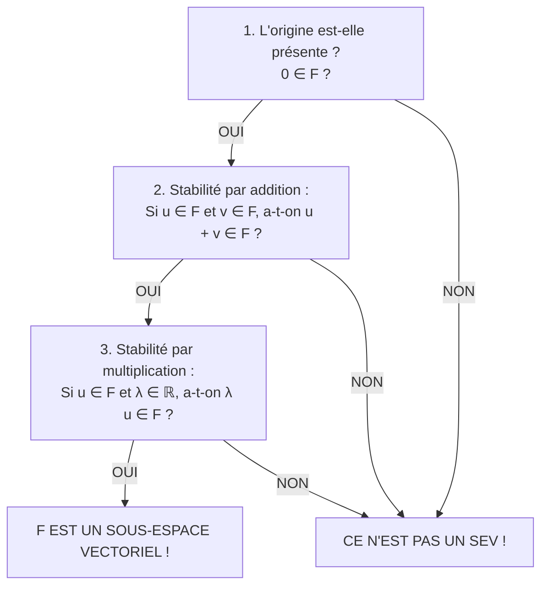
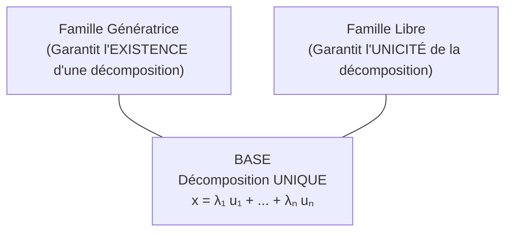

# 📘 Chapitre 1 : Espaces Vectoriels Réels
### *Cours d'Algèbre Linéaire et Calcul Matriciel — Business Analyst (ICHEC)*

---

## 🧒 1. L'Intuition pour un Enfant : La Boîte de Lego Magique

Imagine que tu possèdes une boîte de Lego magique :
- Tu as deux briques spéciales : une **brique rouge** (qui avance vers la droite) et une **brique bleue** (qui monte vers le haut).
- La règle du jeu te permet de faire seulement deux choses :
  1. **Allonger ou rétrécir** une brique (ex: multiplier sa longueur par 2, par 0,5 ou par $-1$ pour aller en arrière). C'est la **multiplication par un scalaire**.
  2. **Accrocher** deux briques bout à bout pour aller dans une nouvelle direction. C'est **l'addition de vecteurs**.

L'espace vectoriel, c'est **tout le terrain de jeu** que tu peux atteindre en combinant ces briques !
- Si tes deux briques te permettent d'atteindre **n'importe quel point de ta chambre**, alors ta boîte de Lego est une **famille génératrice** de ta chambre.
- Si aucune de tes briques n'est inutile (c'est-à-dire qu'aucune brique ne fait exactement le même travail qu'une autre), alors tes briques forment une **famille libre**.
- Et si tu as exactement le nombre parfait de briques pour explorer toute ta chambre sans aucune brique superflue, tu as une **base** !

---

## 🧱 2. L'Espace $\mathbb{R}^n$ et ses Opérations de Base

### A. Définition Formelle
L'ensemble $\mathbb{R}^n$ est l'ensemble de tous les vecteurs possédant $n$ composantes réelles rangées sous forme de **colonne** :
$$
\mathbb{R}^n = \left\{ \begin{pmatrix} x_1 \\ x_2 \\ \vdots \\ x_n \end{pmatrix} \;\middle|\; x_1, x_2, \dots, x_n \in \mathbb{R} \right\}
$$

- $n = 1$ : $\mathbb{R}$ est la **droite numérique** (une seule mesure, ex: un prix).
- $n = 2$ : $\mathbb{R}^2$ est le **plan** (deux dimensions, ex: latitude et longitude, ou dépenses et revenus).
- $n = 3$ : $\mathbb{R}^3$ est **l'espace usuel** en 3D (longueur, largeur, hauteur).
- $n \ge 4$ : $\mathbb{R}^n$ est un **hyper-espace** à $n$ variables. On ne peut plus le dessiner facilement dans notre monde physique, mais **les formules mathématiques et les règles de calcul restent strictement identiques** !

### B. Les Deux Opérations Fondamentales
Soient deux vecteurs $\mathbf{u} = \begin{pmatrix} x_1 \\ \vdots \\ x_n \end{pmatrix}$ et $\mathbf{v} = \begin{pmatrix} y_1 \\ \vdots \\ y_n \end{pmatrix} \in \mathbb{R}^n$, et un nombre réel $\lambda \in \mathbb{R}$ (appelé un **scalaire**) :

1. **L'addition vectorielle :** On additionne composante par composante :
   $$
   \mathbf{u} + \mathbf{v} = \begin{pmatrix} x_1 + y_1 \\ \vdots \\ x_n + y_n \end{pmatrix}
   $$
2. **La multiplication par un scalaire :** Le nombre $\lambda$ multiplie chaque composante :
   $$
   \lambda \mathbf{u} = \begin{pmatrix} \lambda x_1 \\ \vdots \\ \lambda x_n \end{pmatrix}
   $$

#### Exemple Numérique Visuel :
Dans $\mathbb{R}^2$ :
$$
\begin{pmatrix} 2 \\ 1 \end{pmatrix} + \begin{pmatrix} -1 \\ 3 \end{pmatrix} = \begin{pmatrix} 2 + (-1) \\ 1 + 3 \end{pmatrix} = \begin{pmatrix} 1 \\ 4 \end{pmatrix}
\quad \text{et} \quad
3 \begin{pmatrix} 2 \\ 1 \end{pmatrix} = \begin{pmatrix} 3 \times 2 \\ 3 \times 1 \end{pmatrix} = \begin{pmatrix} 6 \\ 3 \end{pmatrix}
$$

---

### C. La Définition Mathématique d'un Espace Vectoriel (Les 8 Axiomes)

Un ensemble $E$ muni d'une addition et d'une multiplication par un scalaire est appelé un **espace vectoriel réel** s'il vérifie 8 propriétés fondamentales :

| Propriété | Formulation Mathématique | Ce que cela veut dire simplement |
| :--- | :--- | :--- |
| **1. Commutativité** | $\forall \mathbf{u}, \mathbf{v} \in E : \mathbf{u} + \mathbf{v} = \mathbf{v} + \mathbf{u}$ | L'ordre dans lequel on additionne ne change rien. |
| **2. Associativité** | $(\mathbf{u} + \mathbf{v}) + \mathbf{w} = \mathbf{u} + (\mathbf{v} + \mathbf{w})$ | On peut regrouper les termes comme on veut. |
| **3. Élément neutre** | $\exists \mathbf{0} \in E, \forall \mathbf{u} \in E : \mathbf{u} + \mathbf{0} = \mathbf{u}$ | Il existe un point d'origine qui ne bouge rien. |
| **4. Élément opposé** | $\forall \mathbf{u} \in E, \exists (-\mathbf{u}) \in E : \mathbf{u} + (-\mathbf{u}) = \mathbf{0}$ | On peut toujours faire demi-tour et revenir à zéro. |
| **5. Distributivité (scalaires)** | $\lambda(\mathbf{u} + \mathbf{v}) = \lambda\mathbf{u} + \lambda\mathbf{v}$ | Multiplier une somme équivaut à sommer les multiples. |
| **6. Distributivité (vecteurs)** | $(\lambda + \mu)\mathbf{u} = \lambda\mathbf{u} + \mu\mathbf{u}$ | Répartir un vecteur sur deux facteurs scalaires. |
| **7. Associativité mixte** | $(\lambda \mu)\mathbf{u} = \lambda(\mu \mathbf{u})$ | Multiplier par 2 puis par 3 revient à multiplier par 6. |
| **8. Neutre multiplicatif** | $1 \mathbf{u} = \mathbf{u}$ | Multiplier par 1 ne déforme pas le vecteur. |

> [!NOTE]
> Pour tout entier $n \ge 1$, **$\mathbb{R}^n$ est un espace vectoriel réel**. Dans tout ce cours, nous travaillerons exclusivement dans $\mathbb{R}^n$.

---

## 🛡️ 3. Les Sous-Espaces Vectoriels (SEV)

### A. Qu'est-ce qu'un Sous-Espace Vectoriel ?
Imagine que $\mathbb{R}^2$ est toute la surface d'une table infinie. Un **sous-espace vectoriel** $F$, c'est une zone tracé sur cette table qui se comporte elle-même comme un univers miniature complet : si tu ajoutes deux vecteurs situés dans $F$, ou si tu les étires, **tu restes toujours dans $F$** !

### B. Le Critère Pratique en 3 Étapes (À APPRENDRE PAR CŒUR)
Pour prouver qu'un sous-ensemble $F \subseteq \mathbb{R}^n$ est un sous-espace vectoriel, **inutile de vérifier les 8 axiomes** ! Il suffit de vérifier les **3 conditions du critère pratique** :

> [!IMPORTANT]
> **Règle d'or de la démonstration à l'examen :**
> - Pour prouver qu'un ensemble **EST** un sous-espace vectoriel, il faut faire la preuve avec des lettres générales ($x_1, x_2, \lambda$). Un exemple chiffré ne prouve rien !
> - Pour prouver qu'un ensemble **N'EST PAS** un sous-espace vectoriel, **un seul contre-exemple chiffré suffit** !

---

### C. Exemple Détaillé : Une Droite Passant par l'Origine
Soit $F = \left\{ \begin{pmatrix} x \\ y \end{pmatrix} \in \mathbb{R}^2 \;\middle|\; y = 2x \right\}$. Montrons que $F$ est un SEV de $\mathbb{R}^2$.

1. **Présence du vecteur nul :**
   Pour $\begin{pmatrix} 0 \\ 0 \end{pmatrix}$, on a $x = 0$ et $y = 0$.
   Or $0 = 2 \times 0$, donc la condition est vérifiée : $\mathbf{0} \in F$.
2. **Stabilité par addition :**
   Soient deux vecteurs quelconques de $F$ :
   $\mathbf{u} = \begin{pmatrix} x_1 \\ 2x_1 \end{pmatrix} \in F$ et $\mathbf{v} = \begin{pmatrix} x_2 \\ 2x_2 \end{pmatrix} \in F$.
   Calculons leur somme :
   $$
   \mathbf{u} + \mathbf{v} = \begin{pmatrix} x_1 + x_2 \\ 2x_1 + 2x_2 \end{pmatrix} = \begin{pmatrix} x_1 + x_2 \\ 2(x_1 + x_2) \end{pmatrix}
   $$
   La deuxième composante est bien égale à 2 fois la première ! Donc $\mathbf{u} + \mathbf{v} \in F$.
3. **Stabilité par multiplication par un scalaire :**
   Soient $\mathbf{u} = \begin{pmatrix} x_1 \\ 2x_1 \end{pmatrix} \in F$ et $\lambda \in \mathbb{R}$.
   Calculons :
   $$
   \lambda \mathbf{u} = \begin{pmatrix} \lambda x_1 \\ \lambda (2x_1) \end{pmatrix} = \begin{pmatrix} \lambda x_1 \\ 2(\lambda x_1) \end{pmatrix}
   $$
   La deuxième composante est bien égale à 2 fois la première ! Donc $\lambda \mathbf{u} \in F$.

**Conclusion :** $F$ vérifie les trois conditions, c'est donc un sous-espace vectoriel de $\mathbb{R}^2$.

---

### D. Les 3 Contre-Exemples Pièges Classiques d'Examen

#### Contre-Exemple 1 : La droite qui ne passe pas par l'origine
Soit $F = \left\{ \begin{pmatrix} x \\ y \end{pmatrix} \in \mathbb{R}^2 \;\middle|\; x + y = 1 \right\}$.
- Testons le vecteur nul $\begin{pmatrix} 0 \\ 0 \end{pmatrix}$ : $0 + 0 = 0 \neq 1$.
- $\mathbf{0} \notin F \implies$ **$F$ n'est pas un sous-espace vectoriel**. *(Test plié en 5 secondes !)*

#### Contre-Exemple 2 : Une équation avec des puissances (la parabole)
Soit $F = \left\{ \begin{pmatrix} x \\ y \end{pmatrix} \in \mathbb{R}^2 \;\middle|\; y = x^2 \right\}$.
- Le vecteur nul y est ($0 = 0^2$). Mais testons la somme avec un contre-exemple :
  Prenons $\mathbf{u} = \begin{pmatrix} 1 \\ 1 \end{pmatrix} \in F$ (car $1 = 1^2$) et $\mathbf{v} = \begin{pmatrix} 2 \\ 4 \end{pmatrix} \in F$ (car $4 = 2^2$).
  $$
  \mathbf{u} + \mathbf{v} = \begin{pmatrix} 1+2 \\ 1+4 \end{pmatrix} = \begin{pmatrix} 3 \\ 5 \end{pmatrix}
  $$
  Or, $3^2 = 9 \neq 5$, donc $\mathbf{u} + \mathbf{v} \notin F$ !
- **Conclusion :** $F$ n'est pas stable par addition, ce n'est pas un SEV.

#### Contre-Exemple 3 : Les produits croisés (la croix des axes)
Soit $F = \left\{ \begin{pmatrix} x \\ y \end{pmatrix} \in \mathbb{R}^2 \;\middle|\; xy = 0 \right\}$ (l'axe des $x$ réuni avec l'axe des $y$).
- Prenons $\mathbf{u} = \begin{pmatrix} 1 \\ 0 \end{pmatrix} \in F$ ($1 \times 0 = 0$) et $\mathbf{v} = \begin{pmatrix} 0 \\ 1 \end{pmatrix} \in F$ ($0 \times 1 = 0$).
- Leur somme est $\mathbf{u} + \mathbf{v} = \begin{pmatrix} 1 \\ 1 \end{pmatrix}$.
- Le produit des composantes donne $1 \times 1 = 1 \neq 0$, donc $\mathbf{u} + \mathbf{v} \notin F$ !
- **Conclusion :** Ce n'est pas un sous-espace vectoriel.

---

## 🍳 4. Combinaisons Linéaires et Familles Génératrices

### A. Combinaison Linéaire
Une **combinaison linéaire** de vecteurs $\mathbf{u}_1, \dots, \mathbf{u}_p$ est n'importe quel vecteur obtenu en multipliant chacun par un coefficient réel puis en les additionnant :
$$
\mathbf{w} = \lambda_1 \mathbf{u}_1 + \lambda_2 \mathbf{u}_2 + \dots + \lambda_p \mathbf{u}_p = \sum_{i=1}^p \lambda_i \mathbf{u}_i
$$
*Analogie :* Si tes ingrédients sont la farine et les œufs, une combinaison linéaire est une pâte contenant $2$ doses de farine et $3$ œufs.

### B. Le Sous-Espace Engendré ($\operatorname{Vect}$)
L'ensemble de **toutes** les combinaisons linéaires possibles d'une famille de vecteurs s'appelle le sous-espace engendré, noté $\operatorname{Vect}(\mathbf{u}_1, \dots, \mathbf{u}_p)$ (ou *Span* en anglais) :
$$
\operatorname{Vect}(\mathbf{u}_1, \dots, \mathbf{u}_p) = \left\{ \sum_{i=1}^p \lambda_i \mathbf{u}_i \;\middle|\; \lambda_1, \dots, \lambda_p \in \mathbb{R} \right\}
$$
- Avec 1 seul vecteur non nul : $\operatorname{Vect}(\mathbf{u})$ forme une **droite** passant par l'origine.
- Avec 2 vecteurs non colinéaires : $\operatorname{Vect}(\mathbf{u}, \mathbf{v})$ forme un **plan** passant par l'origine.

---

### C. Famille Génératrice
Une famille $(\mathbf{u}_1, \dots, \mathbf{u}_p)$ est dite **génératrice** de l'espace $E$ si :
$$
\operatorname{Vect}(\mathbf{u}_1, \dots, \mathbf{u}_p) = E
$$
Autrement dit : **Tout vecteur de $E$ peut être fabriqué** à l'aide de cette famille.

#### Exemple Détaillé (Slide 18) :
Montrons que la famille formée de $\mathbf{u} = \begin{pmatrix} 1 \\ 2 \end{pmatrix}$ et $\mathbf{v} = \begin{pmatrix} -1 \\ 1 \end{pmatrix}$ est génératrice de $\mathbb{R}^2$.
Prenons un vecteur quelconque $\begin{pmatrix} x \\ y \end{pmatrix} \in \mathbb{R}^2$. Peut-on toujours trouver des scalaires $\lambda, \mu \in \mathbb{R}$ tels que :
$$
\lambda \begin{pmatrix} 1 \\ 2 \end{pmatrix} + \mu \begin{pmatrix} -1 \\ 1 \end{pmatrix} = \begin{pmatrix} x \\ y \end{pmatrix} \iff \begin{cases} \lambda - \mu = x \\ 2\lambda + \mu = y \end{cases}
$$
Résolvons ce système d'équations :
1. Additionnons les deux équations : $(\lambda - \mu) + (2\lambda + \mu) = x + y \implies 3\lambda = x + y \implies \mathbf{\lambda = \frac{x+y}{3}}$.
2. De la première équation, tirons $\mu$ : $\mu = \lambda - x = \frac{x+y}{3} - x = \mathbf{\frac{y-2x}{3}}$.

Puisque nous avons trouvé une solution unique $(\lambda, \mu)$ pour **n'importe quel** couple $(x, y)$, la famille $(\mathbf{u}, \mathbf{v})$ engendre bien tout $\mathbb{R}^2$. Elle est donc **génératrice** !

#### Contre-Exemple Détaillé (Slide 19) :
Considérons $\mathbf{u} = \begin{pmatrix} 1 \\ -1 \end{pmatrix}$ et $\mathbf{v} = \begin{pmatrix} -1 \\ 1 \end{pmatrix}$.
Ces deux vecteurs sont colinéaires ($\mathbf{v} = -\mathbf{u}$). Ils ne pointent que sur la droite $y = -x$.
Essayons par exemple de fabriquer le vecteur $\begin{pmatrix} 1 \\ 0 \end{pmatrix}$ :
$$
\lambda \begin{pmatrix} 1 \\ -1 \end{pmatrix} + \mu \begin{pmatrix} -1 \\ 1 \end{pmatrix} = \begin{pmatrix} 1 \\ 0 \end{pmatrix} \iff \begin{cases} \lambda - \mu = 1 \\ -\lambda + \mu = 0 \end{cases}
$$
En sommant les deux équations : $0 = 1$, ce qui est **impossible** !
Donc $\begin{pmatrix} 1 \\ 0 \end{pmatrix} \notin \operatorname{Vect}(\mathbf{u}, \mathbf{v})$. La famille **n'est pas génératrice** de $\mathbb{R}^2$.

---

## 🪢 5. Indépendance Linéaire : Famille Libre vs Famille Liée

### A. Pourquoi parler d'indépendance ? (La Redondance)
Regarde ces trois vecteurs :
$$
\mathbf{u}_1 = \begin{pmatrix} 2 \\ 1 \\ -1 \end{pmatrix}, \quad \mathbf{u}_2 = \begin{pmatrix} 0 \\ 3 \\ 2 \end{pmatrix}, \quad \mathbf{u}_3 = \begin{pmatrix} 2 \\ 4 \\ 1 \end{pmatrix}
$$
Remarque que $\mathbf{u}_1 + \mathbf{u}_2 = \begin{pmatrix} 2+0 \\ 1+3 \\ -1+2 \end{pmatrix} = \begin{pmatrix} 2 \\ 4 \\ 1 \end{pmatrix} = \mathbf{u}_3$.
Le vecteur $\mathbf{u}_3$ n'apporte **aucune information nouvelle** ! Il est totalement redondant. On peut écrire :
$$
\mathbf{u}_1 + \mathbf{u}_2 - \mathbf{u}_3 = \mathbf{0}
$$
C'est une combinaison linéaire non triviale qui donne le vecteur nul. Les vecteurs sont dits **liés**.

---

### B. Définition Formelle d'une Famille Libre
Une famille $(\mathbf{u}_1, \dots, \mathbf{u}_p)$ est dite **libre** si la seule et unique façon d'obtenir le vecteur nul avec une combinaison linéaire est de mettre tous les coefficients à zéro (la solution triviale) :
$$
\lambda_1 \mathbf{u}_1 + \lambda_2 \mathbf{u}_2 + \dots + \lambda_p \mathbf{u}_p = \mathbf{0} \implies \lambda_1 = \lambda_2 = \dots = \lambda_p = 0
$$

- **Interprétation :** Une famille est libre si elle ne contient **aucun vecteur redondant**. Aucun vecteur ne peut s'écrire comme une combinaison des autres.
- Une famille qui n'est pas libre est dite **liée**.

---

### C. Exemple de Démonstration d'une Famille Libre (Slide 23)
Soit la famille dans $\mathbb{R}^3$ :
$$
\mathbf{u}_1 = \begin{pmatrix} 1 \\ 1 \\ 0 \end{pmatrix}, \quad \mathbf{u}_2 = \begin{pmatrix} 1 \\ 0 \\ 1 \end{pmatrix}, \quad \mathbf{u}_3 = \begin{pmatrix} 0 \\ 1 \\ 1 \end{pmatrix}
$$
Posons l'équation vectorielle : $\lambda_1 \mathbf{u}_1 + \lambda_2 \mathbf{u}_2 + \lambda_3 \mathbf{u}_3 = \mathbf{0}$.
Ce qui donne le système linéaire :
$$
\begin{cases}
\lambda_1 + \lambda_2 = 0 & (L_1) \\
\lambda_1 + \lambda_3 = 0 & (L_2) \\
\lambda_2 + \lambda_3 = 0 & (L_3)
\end{cases}
$$
Résolution :
- De $(L_1)$ : $\lambda_2 = -\lambda_1$.
- De $(L_2)$ : $\lambda_3 = -\lambda_1$.
- Remplaçons dans $(L_3)$ : $(-\lambda_1) + (-\lambda_1) = 0 \implies -2\lambda_1 = 0 \implies \lambda_1 = 0$.
- Par suite, $\lambda_2 = 0$ et $\lambda_3 = 0$.

**Conclusion :** La seule solution est $\lambda_1 = \lambda_2 = \lambda_3 = 0$. La famille $(\mathbf{u}_1, \mathbf{u}_2, \mathbf{u}_3)$ est donc **libre** !

---

## 🎯 6. Bases et Dimension

### A. Définition d'une Base
Une famille $\mathcal{B} = (\mathbf{u}_1, \dots, \mathbf{u}_n)$ est une **base** d'un espace vectoriel $E$ si elle est à la fois :
1. **Génératrice** (elle peut tout fabriquer dans $E$),
2. **Libre** (elle n'a aucun vecteur superflu).

C'est le compromis parfait : **assez de vecteurs, mais pas trop** !

### B. La Base Canonique de $\mathbb{R}^n$
C'est la base la plus simple et naturelle, constituée de zéros partout sauf un 1 sur chaque ligne :
$$
\mathbf{e}_1 = \begin{pmatrix} 1 \\ 0 \\ \vdots \\ 0 \end{pmatrix}, \quad \mathbf{e}_2 = \begin{pmatrix} 0 \\ 1 \\ \vdots \\ 0 \end{pmatrix}, \quad \dots, \quad \mathbf{e}_n = \begin{pmatrix} 0 \\ 0 \\ \vdots \\ 1 \end{pmatrix}
$$

---

### C. La Dimension et ses Conséquences Pratiques
- **Théorème fondamental :** Dans un espace vectoriel de dimension finie, **toutes les bases comportent exactement le même nombre de vecteurs**.
- Ce nombre unique s'appelle la **dimension** de $E$, notée $\dim(E)$.
  $$\dim(\mathbb{R}) = 1, \quad \dim(\mathbb{R}^2) = 2, \quad \dim(\mathbb{R}^3) = 3, \quad \dim(\mathbb{R}^n) = n$$

#### Les Règles d'Or Pratiques en Dimension $n$ :
Soit $E$ un espace vectoriel de dimension $n$ :
1. Toute famille génératrice contient **au moins $n$ vecteurs** ($\ge n$). Si tu as moins de $n$ vecteurs, c'est impossible qu'elle engendre tout l'espace !
2. Toute famille libre contient **au plus $n$ vecteurs** ($\le n$). Si tu as plus de $n$ vecteurs, ils sont obligatoirement liés !
3. **Le Théorème Raccourci d'Examen :**
   Si une famille contient **exactement $n$ vecteurs**, alors :
   $$\text{Famille Libre} \iff \text{Famille Génératrice} \iff \text{Base !}$$
   *Conséquence pratique :* En dimension $n$, avec $n$ vecteurs, **il suffit de tester une seule des deux propriétés** (généralement la liberté) pour prouver que c'est une base !

#### Exemples Rapides de Reconnaissance (Slide 29) :
- Une famille de **2 vecteurs** dans $\mathbb{R}^3$ : **Ne peut pas être génératrice** car $2 < 3$.
- Une famille de **4 vecteurs** dans $\mathbb{R}^3$ : **Ne peut pas être libre** car $4 > 3$.
- Une famille de **3 vecteurs libres** dans $\mathbb{R}^3$ : **C'est automatiquement une base de $\mathbb{R}^3$** car la taille est égale à la dimension ($3 = 3$).

---

## 📍 7. Coordonnées d'un Vecteur dans une Base

### A. Définition
Soit $\mathcal{B} = (\mathbf{u}_1, \dots, \mathbf{u}_n)$ une base de $E$.
Puisque $\mathcal{B}$ est une base, tout vecteur $\mathbf{x} \in E$ s'exprime de façon **unique** sous la forme :
$$
\mathbf{x} = \lambda_1 \mathbf{u}_1 + \lambda_2 \mathbf{u}_2 + \dots + \lambda_n \mathbf{u}_n
$$
Les scalaires uniques $(\lambda_1, \dots, \lambda_n)$ sont appelés les **coordonnées de $\mathbf{x}$ dans la base $\mathcal{B}$**, notées :
$$
[\mathbf{x}]_\mathcal{B} = \begin{pmatrix} \lambda_1 \\ \lambda_2 \\ \vdots \\ \lambda_n \end{pmatrix}
$$

> [!WARNING]
> Un vecteur physique est un objet absolu dans l'espace, mais ses **coordonnées dépendent totalement de la base choisie** ! Changer de base, c'est comme changer de langue pour décrire le même endroit.

---

### B. Exemple de Calcul Pas à Pas (Slide 32)
Dans $\mathbb{R}^2$, considérons la base $\mathcal{B} = (\mathbf{u}_1, \mathbf{u}_2)$ avec :
$$
\mathbf{u}_1 = \begin{pmatrix} 1 \\ 1 \end{pmatrix}, \quad \mathbf{u}_2 = \begin{pmatrix} 1 \\ -1 \end{pmatrix}
$$
Prenons le vecteur $\mathbf{x} = \begin{pmatrix} 4 \\ 2 \end{pmatrix}$.
Dans la base canonique, ses coordonnées sont évidemment $[\mathbf{x}]_{\text{can}} = \begin{pmatrix} 4 \\ 2 \end{pmatrix}$.

Quelles sont ses coordonnées dans la base $\mathcal{B}$ ?
On cherche les scalaires $\lambda_1, \lambda_2$ tels que :
$$
\mathbf{x} = \lambda_1 \mathbf{u}_1 + \lambda_2 \mathbf{u}_2 \iff \lambda_1 \begin{pmatrix} 1 \\ 1 \end{pmatrix} + \lambda_2 \begin{pmatrix} 1 \\ -1 \end{pmatrix} = \begin{pmatrix} 4 \\ 2 \end{pmatrix}
$$
Ce qui donne le système linéaire :
$$
\begin{cases}
\lambda_1 + \lambda_2 = 4 \\
\lambda_1 - \lambda_2 = 2
\end{cases}
$$
1. Sommons les deux équations : $2\lambda_1 = 6 \implies \mathbf{\lambda_1 = 3}$.
2. Remplaçons dans la première : $3 + \lambda_2 = 4 \implies \mathbf{\lambda_2 = 1}$.

On conclut :
$$
[\mathbf{x}]_\mathcal{B} = \begin{pmatrix} 3 \\ 1 \end{pmatrix}
$$
**Vérification :** $3 \mathbf{u}_1 + 1 \mathbf{u}_2 = 3 \begin{pmatrix} 1 \\ 1 \end{pmatrix} + 1 \begin{pmatrix} 1 \\ -1 \end{pmatrix} = \begin{pmatrix} 3+1 \\ 3-1 \end{pmatrix} = \begin{pmatrix} 4 \\ 2 \end{pmatrix} = \mathbf{x}$. C'est parfait !

---

## 🗣️ 8. Le Guide de l'Oral : Comment décrire ces notions à l'examen

- **Pour prouver qu'un ensemble est un sous-espace vectoriel :**
  > *"Je vérifie les 3 conditions : premièrement, le vecteur nul appartient bien à l'ensemble car ses composantes satisfont l'équation. Deuxièmement, en prenant deux éléments quelconques u et v vérifiant la contrainte, leur somme la vérifie également par linéarité. Troisièmement, le produit par un scalaire lambda quelconque préserve la condition. L'ensemble est donc un sous-espace vectoriel."*
- **Pour justifier qu'une famille est libre :**
  > *"J'écris la combinaison linéaire nulle $\lambda_1 u_1 + \dots + \lambda_p u_p = 0$. Cela m'amène à un système d'équations linéaires homogène. Comme l'unique solution de ce système est la solution triviale où tous les scalaires sont nuls, la famille ne contient aucune redondance : elle est libre."*
- **Pour justifier qu'une famille est une base :**
  > *"Nous travaillons dans un espace de dimension $n$. La famille étudiée contient exactement $n$ vecteurs. Puisqu'elle est libre, d'après le théorème de la dimension, elle est automatiquement génératrice et constitue donc une base de l'espace."*

---

## 📌 9. À Retenir Absolument (Points Clés du Chapitre 1)

1. **Critère SEV :** $0 \in F$, stable par $+$, stable par $\times \lambda$.
2. **Famille génératrice :** Permet de reconstituer tout l'espace ($\operatorname{Vect} = E$).
3. **Famille libre :** Aucun vecteur n'est une combinaison linéaire des autres ($\sum \lambda_i u_i = 0 \implies \lambda_i = 0$).
4. **Base :** Famille à la fois génératrice et libre.
5. **Dimension :** Nombre de vecteurs dans n'importe quelle base de l'espace.
6. **En dimension $n$ :**
   - Moins de $n$ vecteurs $\implies$ Jamais génératrice.
   - Plus de $n$ vecteurs $\implies$ Jamais libre.
   - Exactement $n$ vecteurs $\implies$ Libre $\iff$ Génératrice $\iff$ Base.
7. Les coordonnées $[\mathbf{x}]_\mathcal{B}$ sont les poids uniques de la décomposition de $\mathbf{x}$ sur les vecteurs de la base $\mathcal{B}$.

---

➡️ **Passer au chapitre suivant :** [Chapitre 2 : Applications Linéaires](file:///c:/Users/cemmi/OneDrive%20-%20ICHEC/Math/Alg%C3%A8bre/Guides_de_Cours_Complets/Chapitre_2_Applications_Lineaires.md)
