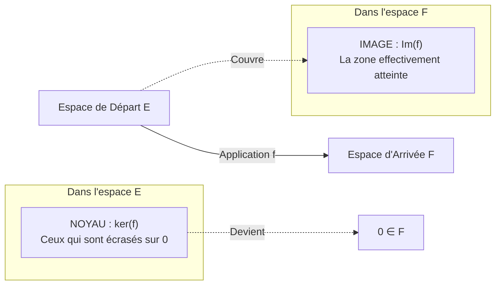
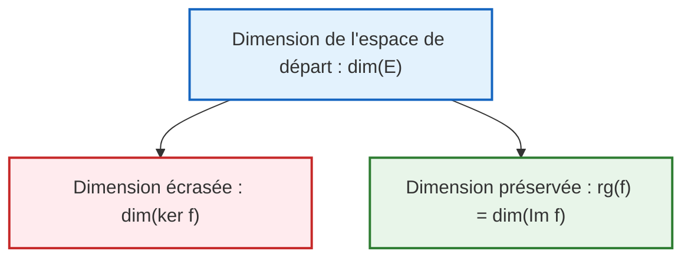

# 📘 Chapitre 2 : Applications Linéaires
### *Cours d'Algèbre Linéaire et Calcul Matriciel — Business Analyst (ICHEC)*

---

## 🧒 1. L'Intuition pour un Enfant : La Machine de Transformation Magique

Imagine une usine miniature avec une **machine de transformation** :
- Tu lui donnes en entrée un panier avec des ingrédients (un vecteur $\mathbf{u}$).
- La machine travaille et te ressort un produit fini (un vecteur $f(\mathbf{u})$).

Pour que cette machine soit dite **linéaire**, elle doit respecter **deux règles d'honnêteté absolue** :
1. **La règle de l'addition :** Si tu mets le panier $\mathbf{u}$ et le panier $\mathbf{v}$ ensemble dans la machine, le résultat qui sort doit être exactement le résultat de $\mathbf{u}$ **plus** le résultat de $\mathbf{v}$ :
   $$f(\mathbf{u} + \mathbf{v}) = f(\mathbf{u}) + f(\mathbf{v})$$
2. **La règle de la proportionnalité :** Si tu doubles les ingrédients (ou si tu les multiplies par 3 ou 10), la machine doit te sortir exactement le double (ou le triple) de produits :
   $$f(\lambda \mathbf{u}) = \lambda f(\mathbf{u})$$

> [!NOTE]
> **Conséquence magique immédiate :** Si tu ne mets rien dans la machine ($\mathbf{0}$ ingrédient), il ne doit **rien sortir du tout** !
> Une application linéaire envoie **toujours** le vecteur nul sur le vecteur nul :
> $$f(\mathbf{0}) = \mathbf{0}$$
> Si une fonction ne respecte pas cela (par exemple si $f(0) = 5$), **elle n'est pas linéaire** !

---

## ⚙️ 2. Définition et Reconnaissance d'une Application Linéaire

### A. Définition Mathématique Formelle
Soient deux espaces vectoriels réels $E$ (l'espace de départ) et $F$ (l'espace d'arrivée).
Une fonction $f : E \to F$ est une **application linéaire** si :
1. $\forall \mathbf{u}, \mathbf{v} \in E : f(\mathbf{u} + \mathbf{v}) = f(\mathbf{u}) + f(\mathbf{v})$
2. $\forall \mathbf{u} \in E, \forall \lambda \in \mathbb{R} : f(\lambda \mathbf{u}) = \lambda f(\mathbf{u})$

*(On peut résumer ces deux conditions en une seule : $\forall \mathbf{u}, \mathbf{v} \in E, \forall \lambda, \mu \in \mathbb{R} : f(\lambda \mathbf{u} + \mu \mathbf{v}) = \lambda f(\mathbf{u}) + \mu f(\mathbf{v})$).*

---

### B. Le Raccourci Visuel dans $\mathbb{R}^n$ (Critère Ultime d'Examen)
Comment reconnaître immédiatement si une application $f : \mathbb{R}^n \to \mathbb{R}^m$ est linéaire sans calculs fastidieux ?

> [!TIP]
> **Critère des composantes :**
> Une application est linéaire si et seulement si **chacune de ses composantes de sortie est une simple somme de termes du premier degré** en $x_1, x_2, \dots, x_n$, **sans aucune constante ajoutée**, **sans puissances**, **sans produits croisés** et **sans fonctions non linéaires** ($\sin, \cos, \exp$).

#### Exemples Comparatifs :

| Application | Linéaire ? | Pourquoi ? (Justification pour l'examen) |
| :--- | :---: | :--- |
| $f\begin{pmatrix} x \\ y \end{pmatrix} = \begin{pmatrix} y \\ -x + 3y \end{pmatrix}$ | **OUI** | Combinaisons linéaires pures de $x$ et $y$ sans constante ni terme non linéaire. |
| $f\begin{pmatrix} x \\ y \end{pmatrix} = \begin{pmatrix} 2x + 1 \\ y \end{pmatrix}$ | **NON** | Il y a une constante ($+1$). Remarque : $f\begin{pmatrix} 0 \\ 0 \end{pmatrix} = \begin{pmatrix} 1 \\ 0 \end{pmatrix} \neq \begin{pmatrix} 0 \\ 0 \end{pmatrix}$. |
| $f\begin{pmatrix} x \\ y \end{pmatrix} = \begin{pmatrix} x^2 \\ y \end{pmatrix}$ | **NON** | Présence d'un carré ($x^2$). Si on double $x$, $x^2$ est multiplié par 4 (pas par 2) ! |
| $f\begin{pmatrix} x \\ y \end{pmatrix} = \begin{pmatrix} xy \\ x - y \end{pmatrix}$ | **NON** | Présence d'un produit croisé ($xy$). |

---

## 🕳️ 3. Le Noyau ($\ker$) et l'Image ($\operatorname{Im}$) : Les Deux Visages d'une Application

Quand une application linéaire agit sur un espace, deux questions fondamentales se posent :

### A. Le Noyau ($\ker f$) : Le Trou Noir
- **Définition :** C'est l'ensemble de tous les vecteurs de départ que la machine envoie sur le vecteur nul $\mathbf{0}$ :
  $$
  \ker(f) = \{ \mathbf{x} \in E \mid f(\mathbf{x}) = \mathbf{0} \}
  $$
- *(Le mot "ker" vient de l'allemand Kern qui signifie "noyau").*
- **Propriété essentielle :** $\ker(f)$ est un **sous-espace vectoriel** de l'espace de départ $E$.

---

### B. L'Image ($\operatorname{Im} f$) : La Carte des Cibles Atteintes
- **Définition :** C'est l'ensemble de tous les vecteurs de l'espace d'arrivée qui peuvent être fabriqués par la machine :
  $$
  \operatorname{Im}(f) = \{ f(\mathbf{x}) \in F \mid \mathbf{x} \in E \}
  $$
- **Propriété essentielle :** $\operatorname{Im}(f)$ est un **sous-espace vectoriel** de l'espace d'arrivée $F$.

---

### C. Exemple d'Application Visuelle : La Projection Orthogonale
Considérons l'application qui projette un point du plan sur l'axe horizontal :
$$
f : \mathbb{R}^2 \to \mathbb{R}^2 : \begin{pmatrix} x \\ y \end{pmatrix} \mapsto \begin{pmatrix} x \\ 0 \end{pmatrix}
$$
- **Son noyau :** Quels points sont envoyés sur $\begin{pmatrix} 0 \\ 0 \end{pmatrix}$ ?
  Il faut que $x = 0$. Donc $\ker(f) = \left\{ \begin{pmatrix} 0 \\ y \end{pmatrix} \;\middle|\; y \in \mathbb{R} \right\}$.
  C'est tout **l'axe vertical des ordonnées (l'axe $y$)** ! Tout cet axe est écrasé sur l'origine.
- **Son image :** Que peut-on obtenir en sortie ?
  Tous les vecteurs ont une ordonnée nulle. Donc $\operatorname{Im}(f) = \left\{ \begin{pmatrix} x \\ 0 \end{pmatrix} \;\middle|\; x \in \mathbb{R} \right\}$.
  C'est tout **l'axe horizontal des abscisses (l'axe $x$)** !

---

### D. Calcul Détaillé de $\ker(f)$ et $\operatorname{Im}(f)$ (Exemple officiel des slides 16-17)

Considérons l'application :
$$
f : \mathbb{R}^3 \to \mathbb{R}^3 : \begin{pmatrix} x \\ y \\ z \end{pmatrix} \mapsto \begin{pmatrix} x + y + z \\ x - y + z \\ x + y + z \end{pmatrix}
$$

#### 1. Calcul du Noyau $\ker(f)$ :
On cherche tous les vecteurs $\begin{pmatrix} x \\ y \\ z \end{pmatrix}$ tels que $f\begin{pmatrix} x \\ y \\ z \end{pmatrix} = \begin{pmatrix} 0 \\ 0 \\ 0 \end{pmatrix}$ :
$$
\begin{cases}
x + y + z = 0 & (L_1) \\
x - y + z = 0 & (L_2) \\
x + y + z = 0 & (L_3)
\end{cases}
$$
- La ligne $(L_3)$ est identique à $(L_1)$ (redondante).
- Soustrayons $(L_2)$ de $(L_1)$ :
  $(x + y + z) - (x - y + z) = 0 \implies 2y = 0 \implies \mathbf{y = 0}$.
- Remplaçons $y = 0$ dans $(L_1)$ :
  $x + 0 + z = 0 \implies \mathbf{z = -x}$.

Tous les vecteurs du noyau ont donc la forme :
$$
\begin{pmatrix} x \\ 0 \\ -x \end{pmatrix} = x \begin{pmatrix} 1 \\ 0 \\ -1 \end{pmatrix}
$$
On conclut :
$$
\ker(f) = \operatorname{Vect}\left( \begin{pmatrix} 1 \\ 0 \\ -1 \end{pmatrix} \right) \quad \text{et} \quad \dim(\ker f) = 1
$$
*Interprétation :* Le noyau est une **droite** dans l'espace 3D. Toute cette droite est écrasée en un point unique : l'origine.

---

#### 2. Calcul de l'Image $\operatorname{Im}(f)$ :
On cherche à quelle condition sur $\begin{pmatrix} a \\ b \\ c \end{pmatrix} \in \mathbb{R}^3$ le système suivant admet au moins une solution :
$$
\begin{cases}
x + y + z = a \\
x - y + z = b \\
x + y + z = c
\end{cases}
$$
- Regarde la ligne 1 et la ligne 3 : le membre de gauche est identique ($x+y+z$).
- Pour que le système ne soit pas contradictoire, il est **strictement nécessaire que $a = c$** !
- Quand $a = c$, le système admet toujours des solutions (par exemple en posant $x = \frac{a+b}{2}$, $y = \frac{a-b}{2}$, $z = 0$).

Donc les vecteurs de l'image sont ceux dont la 1ère et la 3ème composante sont identiques :
$$
\begin{pmatrix} a \\ b \\ a \end{pmatrix} = a \begin{pmatrix} 1 \\ 0 \\ 1 \end{pmatrix} + b \begin{pmatrix} 0 \\ 1 \\ 0 \end{pmatrix}
$$
On conclut :
$$
\operatorname{Im}(f) = \operatorname{Vect}\left( \begin{pmatrix} 1 \\ 0 \\ 1 \end{pmatrix}, \begin{pmatrix} 0 \\ 1 \\ 0 \end{pmatrix} \right) \quad \text{et} \quad \dim(\operatorname{Im} f) = 2
$$
*Interprétation :* L'image est un **plan** dans l'espace 3D ($x = z$).

---

## 🔍 4. Injectivité, Surjectivité et Bijectivité

| Notion | Définition Intuitive | Critère Mathématique | Interprétation Concrète |
| :--- | :--- | :--- | :--- |
| **Injective** | "Deux entrées différentes ne donnent jamais la même sortie." | $\mathbf{\ker(f) = \{0\}}$ *(Le noyau est réduit au seul vecteur nul).* | **Aucune perte d'information.** On peut toujours retrouver l'entrée exacte à partir de la sortie. |
| **Surjective** | "La machine peut atteindre tous les points de l'espace d'arrivée." | $\mathbf{\operatorname{Im}(f) = F}$ *(L'image remplit tout l'espace d'arrivée).* | **Aucun déchet / aucune zone inaccessible.** Tout point de $F$ possède au moins un antécédent. |
| **Bijective** | "À chaque entrée correspond une sortie unique, et inversement." | $\mathbf{\ker(f) = \{0\}}$ **ET** $\mathbf{\operatorname{Im}(f) = F}$ | **Réversibilité parfaite.** L'application possède une fonction inverse $f^{-1}$. |

---

## 👑 5. Le Théorème du Rang (Le Théorème Suprême)

### A. Définition du Rang
Le **rang** d'une application linéaire $f$, noté $\operatorname{rg}(f)$, est tout simplement la dimension de son image :
$$
\operatorname{rg}(f) = \dim(\operatorname{Im}(f))
$$

### B. Énoncé du Théorème du Rang
Soit $f : E \to F$ une application linéaire, où $E$ est de dimension finie :
$$
\mathbf{\dim(E) = \dim(\ker(f)) + \operatorname{rg}(f)}
$$

#### Vérification sur notre exemple précédent :
- Espace de départ $E = \mathbb{R}^3 \implies \dim(E) = 3$.
- Noyau : $\dim(\ker f) = 1$.
- Image : $\operatorname{rg}(f) = \dim(\operatorname{Im} f) = 2$.
- Vérification : $3 = 1 + 2$ ! L'équation de conservation de la dimension est parfaite !

---

### C. Conséquences Majeures pour $f : \mathbb{R}^n \to \mathbb{R}^m$

D'après le théorème du rang, $n = \dim(\ker f) + \operatorname{rg}(f)$, et comme $\operatorname{rg}(f) \le m$ :

1. **Si $n > m$ (L'espace de départ est plus grand que l'espace d'arrivée) :**
   - Exemple : de $\mathbb{R}^3$ vers $\mathbb{R}^2$.
   - $\operatorname{rg}(f) \le 2 \implies \dim(\ker f) = 3 - \operatorname{rg}(f) \ge 1 \neq 0$.
   - **$f$ ne peut JAMAIS être injective !** C'est le principe des tiroirs : écraser un objet 3D sur une feuille 2D entraîne obligatoirement des superpositions.
2. **Si $n < m$ (L'espace de départ est plus petit que l'espace d'arrivée) :**
   - Exemple : de $\mathbb{R}^2$ vers $\mathbb{R}^3$.
   - $\operatorname{rg}(f) \le 2 < 3 \implies \operatorname{Im}(f) \neq \mathbb{R}^3$.
   - **$f$ ne peut JAMAIS être surjective !** Une feuille plate ne peut pas remplir tout un espace 3D.
3. **Cas Crucial : Même Dimension ($n = m$) :**
   Si $f : \mathbb{R}^n \to \mathbb{R}^n$, alors les trois propriétés sont équivalentes :
   $$f \text{ injective} \iff f \text{ surjective} \iff f \text{ bijective}$$
   *À l'examen :* Si $n = m$, il te suffit de vérifier que $\ker(f) = \{0\}$ pour prouver d'un seul coup que l'application est bijective !

---

## 📊 6. Représentation Matricielle d'une Application Linéaire

Une matrice n'est rien d'autre que la **fiche d'identité numérique complète** d'une application linéaire !

### A. Dans les Bases Canoniques (Lecture Éclair Directe)
Soit $f : \mathbb{R}^2 \to \mathbb{R}^2 : \begin{pmatrix} x \\ y \end{pmatrix} \mapsto \begin{pmatrix} 2x + 3y \\ x + 4y \end{pmatrix}$.
Prenons la base canonique $\mathcal{B}_{\text{can}} = (\mathbf{e}_1, \mathbf{e}_2) = \left( \begin{pmatrix} 1 \\ 0 \end{pmatrix}, \begin{pmatrix} 0 \\ 1 \end{pmatrix} \right)$.
Calculons les images des vecteurs de base :
$$
f(\mathbf{e}_1) = f\begin{pmatrix} 1 \\ 0 \end{pmatrix} = \begin{pmatrix} 2(1) + 3(0) \\ 1(1) + 4(0) \end{pmatrix} = \begin{pmatrix} 2 \\ 1 \end{pmatrix}
$$
$$
f(\mathbf{e}_2) = f\begin{pmatrix} 0 \\ 1 \end{pmatrix} = \begin{pmatrix} 2(0) + 3(1) \\ 1(0) + 4(1) \end{pmatrix} = \begin{pmatrix} 3 \\ 4 \end{pmatrix}
$$
On colle ces deux colonnes côte à côte :
$$
A = \begin{pmatrix} 2 & 3 \\ 1 & 4 \end{pmatrix}
$$
> [!TIP]
> **Règle rapide :** Dans les bases canoniques, la matrice s'obtient directement en recopiant les coefficients de $x$ dans la colonne 1, et les coefficients de $y$ dans la colonne 2 !

Pour calculer l'image de n'importe quel vecteur $\mathbf{u} = \begin{pmatrix} x \\ y \end{pmatrix}$, on fait simplement le produit :
$$
f(\mathbf{u}) = A \mathbf{u} = \begin{pmatrix} 2 & 3 \\ 1 & 4 \end{pmatrix} \begin{pmatrix} x \\ y \end{pmatrix} = \begin{pmatrix} 2x + 3y \\ x + 4y \end{pmatrix}
$$

---

### B. Dans des Bases Quelconques : La Notation $[f]_{\mathcal{B}_F \leftarrow \mathcal{B}_E}$

Quand on utilise d'autres bases que la base canonique :
- Soit $\mathcal{B}_E = (\mathbf{e}_1, \dots, \mathbf{e}_n)$ une base de l'espace de départ $E$.
- Soit $\mathcal{B}_F = (\mathbf{f}_1, \dots, \mathbf{f}_m)$ une base de l'espace d'arrivée $F$.

#### Algorithme de construction en 3 étapes :
1. Pour chaque vecteur $\mathbf{e}_i$ de la base de départ $\mathcal{B}_E$, calculer son image $f(\mathbf{e}_i)$.
2. Exprimer chaque image $f(\mathbf{e}_i)$ comme une combinaison linéaire des vecteurs de la base d'arrivée $\mathcal{B}_F$ afin d'obtenir ses coordonnées $[f(\mathbf{e}_i)]_{\mathcal{B}_F}$.
3. Disposer ces colonnes de coordonnées côte à côte pour former la matrice :
$$
[f]_{\mathcal{B}_F \leftarrow \mathcal{B}_E} = \begin{pmatrix} 
\mid & \mid & & \mid \\
[f(\mathbf{e}_1)]_{\mathcal{B}_F} & [f(\mathbf{e}_2)]_{\mathcal{B}_F} & \cdots & [f(\mathbf{e}_n)]_{\mathcal{B}_F} \\
\mid & \mid & & \mid 
\end{pmatrix}
$$

> [!IMPORTANT]
> **Pourquoi la flèche va de droite à gauche ($\mathcal{B}_F \leftarrow \mathcal{B}_E$) ?**
> Pour transformer les coordonnées d'un vecteur $\mathbf{u}$, on applique la matrice :
> $$
> [f(\mathbf{u})]_{\mathcal{B}_F} = [f]_{\mathcal{B}_F \leftarrow \mathcal{B}_E} [\mathbf{u}]_{\mathcal{B}_E}
> $$
> La flèche permet d'aligner visuellement les bases : le $\mathcal{B}_E$ de droite absorbe le $[\mathbf{u}]_{\mathcal{B}_E}$ pour donner un résultat exprimé dans $\mathcal{B}_F$ !

---

### C. Exemple Complet Calculé Pas à Pas (Slides 38-39)

Considérons l'application :
$$
f : \mathbb{R}^2 \to \mathbb{R}^2 : \begin{pmatrix} x \\ y \end{pmatrix} \mapsto \begin{pmatrix} 3x + 2y \\ 5x - 4y \end{pmatrix}
$$
avec les bases :
$$
\mathcal{B}_E = \left( \begin{pmatrix} 2 \\ 1 \end{pmatrix}, \begin{pmatrix} 4 \\ 1 \end{pmatrix} \right) \quad \text{et} \quad \mathcal{B}_F = \left( \begin{pmatrix} 1 \\ 1 \end{pmatrix}, \begin{pmatrix} 1 \\ -1 \end{pmatrix} \right)
$$

#### Étape 1 : Calcul des images des vecteurs de $\mathcal{B}_E$
- Image du premier vecteur :
  $$f\begin{pmatrix} 2 \\ 1 \end{pmatrix} = \begin{pmatrix} 3(2) + 2(1) \\ 5(2) - 4(1) \end{pmatrix} = \begin{pmatrix} 8 \\ 6 \end{pmatrix}$$
- Image du deuxième vecteur :
  $$f\begin{pmatrix} 4 \\ 1 \end{pmatrix} = \begin{pmatrix} 3(4) + 2(1) \\ 5(4) - 4(1) \end{pmatrix} = \begin{pmatrix} 14 \\ 16 \end{pmatrix}$$

#### Étape 2 : Décomposition dans la base d'arrivée $\mathcal{B}_F$
- Pour $\begin{pmatrix} 8 \\ 6 \end{pmatrix}$ : on cherche $\lambda_1, \lambda_2$ tels que :
  $$\lambda_1 \begin{pmatrix} 1 \\ 1 \end{pmatrix} + \lambda_2 \begin{pmatrix} 1 \\ -1 \end{pmatrix} = \begin{pmatrix} 8 \\ 6 \end{pmatrix} \iff \begin{cases} \lambda_1 + \lambda_2 = 8 \\ \lambda_1 - \lambda_2 = 6 \end{cases}$$
  En sommant : $2\lambda_1 = 14 \implies \lambda_1 = 7$, puis $\lambda_2 = 1$.
  Donc $\left[ f\begin{pmatrix} 2 \\ 1 \end{pmatrix} \right]_{\mathcal{B}_F} = \mathbf{\begin{pmatrix} 7 \\ 1 \end{pmatrix}}$.

- Pour $\begin{pmatrix} 14 \\ 16 \end{pmatrix}$ : on cherche $\mu_1, \mu_2$ tels que :
  $$\mu_1 \begin{pmatrix} 1 \\ 1 \end{pmatrix} + \mu_2 \begin{pmatrix} 1 \\ -1 \end{pmatrix} = \begin{pmatrix} 14 \\ 16 \end{pmatrix} \iff \begin{cases} \mu_1 + \mu_2 = 14 \\ \mu_1 - \mu_2 = 16 \end{cases}$$
  En sommant : $2\mu_1 = 30 \implies \mu_1 = 15$, puis $\mu_2 = -1$.
  Donc $\left[ f\begin{pmatrix} 4 \\ 1 \end{pmatrix} \right]_{\mathcal{B}_F} = \mathbf{\begin{pmatrix} 15 \\ -1 \end{pmatrix}}$.

#### Étape 3 : Assemblage de la matrice
On place ces deux colonnes dans la matrice :
$$
[f]_{\mathcal{B}_F \leftarrow \mathcal{B}_E} = \begin{pmatrix} 7 & 15 \\ 1 & -1 \end{pmatrix}
$$

*(Alors que dans la base canonique, la matrice était $\begin{pmatrix} 3 & 2 \\ 5 & -4 \end{pmatrix}$. Deux visages différents de la même application !)*

---

## 🗣️ 7. Le Guide de l'Oral : Comment décrire ces notions à l'examen

- **Pour décrire le calcul du noyau :**
  > *"Pour déterminer le noyau de $f$, je pose le système homogène $f(\mathbf{x}) = \mathbf{0}$. Je résous par substitution ou par pivot de Gauss afin d'exprimer les variables liées en fonction des variables libres. J'en déduis une base du sous-espace vectoriel $\ker(f)$ ainsi que sa dimension."*
- **Pour justifier l'injectivité :**
  > *"Une application linéaire est injective si et seulement si son noyau est réduit au vecteur nul. Le système $f(\mathbf{x}) = \mathbf{0}$ n'admettant que la solution triviale $\mathbf{x} = \mathbf{0}$, $\dim(\ker f) = 0$, donc $f$ est injective."*
- **Pour énoncer et utiliser le théorème du rang :**
  > *"D'après le théorème du rang, la dimension de l'espace de départ est égale à la somme de la dimension du noyau et du rang de l'application. Ayant déjà calculé $\dim(\ker f)$, j'en déduis immédiatement le rang de $f$ sans avoir à paramétrer toute l'image."*

---

## 📌 8. À Retenir Absolument (Points Clés du Chapitre 2)

1. $f$ est linéaire $\iff f(\mathbf{u}+\mathbf{v}) = f(\mathbf{u})+f(\mathbf{v})$ et $f(\lambda \mathbf{u}) = \lambda f(\mathbf{u})$.
2. $f(\mathbf{0}) = \mathbf{0}$ toujours.
3. $\ker(f) = \{\mathbf{x} \mid f(\mathbf{x}) = \mathbf{0}\}$ (sous-espace de départ).
4. $\operatorname{Im}(f) = \{f(\mathbf{x}) \mid \mathbf{x} \in E\}$ (sous-espace d'arrivée).
5. $f$ injective $\iff \ker(f) = \{\mathbf{0}\}$.
6. $f$ surjective $\iff \operatorname{Im}(f) = F \iff \operatorname{rg}(f) = \dim(F)$.
7. **Théorème du rang :** $\dim(E) = \dim(\ker f) + \operatorname{rg}(f)$.
8. En dimension égale ($n = m$) : Injective $\iff$ Surjective $\iff$ Bijective.
9. Colonnes de $[f]_{\mathcal{B}_F \leftarrow \mathcal{B}_E}$ = Coordonnées dans $\mathcal{B}_F$ des images des vecteurs de $\mathcal{B}_E$.

---

➡️ **Passer au chapitre suivant :** [Chapitre 3 : Calcul Matriciel I - Opérations de Base](file:///c:/Users/cemmi/OneDrive%20-%20ICHEC/Math/Alg%C3%A8bre/Guides_de_Cours_Complets/Chapitre_3_Calcul_Matriciel_I_Operations_de_Base.md)
