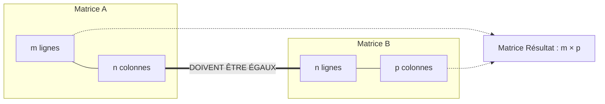

# 📘 Chapitre 3 : Calcul Matriciel I — Opérations de Base
### *Cours d'Algèbre Linéaire et Calcul Matriciel — Business Analyst (ICHEC)*

---

## 🧒 1. L'Intuition pour un Enfant : La Grille de Télécommande et l'Ordre des Chaussures

Imagine une **télécommande géante** avec des boutons rangés en lignes et en colonnes. Cette grille rectangulaire s'appelle une **matrice**.
- Chaque bouton a une adresse précise : par exemple, le bouton à la **ligne 2** et à la **colonne 3**.
- Quand tu appuies sur cette télécommande en lui envoyant un vecteur d'instructions, elle déclenche toute une série de robots à la fois.

Et que se passe-t-il si tu branches **deux télécommandes l'une après l'autre** ?
La première transforme tes instructions, puis la deuxième transforme le résultat de la première. C'est le **produit matriciel** !

Mais attention à la règle d'or la plus importante de tout le calcul matriciel :
> **L'ORDRE DES OPÉRATIONS COMPTE ÉNORMÉMENT !**
> Mets tes **chaussettes** puis tes **chaussures** : tout va bien.
> Mais essaie de mettre tes **chaussures** d'abord, puis tes **chaussettes** par-dessus : le résultat est complètement différent et ridicule !
> Pour les nombres ordinaires, $2 \times 3 = 3 \times 2 = 6$. 
> Mais pour les matrices, **$A \times B \neq B \times A$ en général** !

---

## 📊 2. Définitions et Dimensions d'une Matrice

### A. Qu'est-ce qu'une Matrice ?
Une matrice réelle $A$ de dimensions $m \times n$ (notée $A \in \mathbb{R}^{m \times n}$) est un tableau rectangulaire de nombres réels comportant **$m$ lignes** et **$n$ colonnes** :
$$
A = \begin{pmatrix} 
a_{11} & a_{12} & \cdots & a_{1n} \\
a_{21} & a_{22} & \cdots & a_{2n} \\
\vdots & \vdots & \ddots & \vdots \\
a_{m1} & a_{m2} & \cdots & a_{mn} 
\end{pmatrix}
$$

> [!NOTE]
> **Moyen mnémotechnique universel : $L \times C$ (Ligne par Colonne)**
> Pense au mot **"Li-Ce"** ou **"Livre de Cuisine"** :
> - Le **1er indice $i$** indique le numéro de la **LIGNE** (de 1 à $m$).
> - Le **2ème indice $j$** indique le numéro de la **COLONNE** (de 1 à $n$).
> $a_{23}$ est le nombre situé à la 2ème ligne et à la 3ème colonne.

### B. Matrices Carrées
Si le nombre de lignes est égal au nombre de colonnes ($m = n$), la matrice est dite **carrée d'ordre $n$** ($A \in \mathbb{R}^{n \times n}$).

---

## ➕ 3. Addition et Multiplication par un Scalaire

### A. L'Addition de Deux Matrices : $A + B$
- **Condition obligatoire :** $A$ et $B$ doivent avoir **exactement les mêmes dimensions** ($m \times n$).
- **Calcul :** On additionne les coefficients qui occupent la même case :
  $$(A + B)_{ij} = a_{ij} + b_{ij}$$

#### Exemple :
$$
\begin{pmatrix} 2 & -1 & 3 \\ 0 & 4 & -1 \end{pmatrix} + \begin{pmatrix} 1 & 3 & 0 \\ -2 & 5 & 2 \end{pmatrix} = \begin{pmatrix} 2+1 & -1+3 & 3+0 \\ 0+(-2) & 4+5 & -1+2 \end{pmatrix} = \begin{pmatrix} 3 & 2 & 3 \\ -2 & 9 & 1 \end{pmatrix}
$$

---

### B. La Multiplication par un Scalaire : $\lambda A$
Chaque coefficient du tableau est multiplié par le nombre réel $\lambda$ :
$$(\lambda A)_{ij} = \lambda a_{ij}$$

#### Propriétés Algébriques de ces deux opérations :
1. Commutativité : $A + B = B + A$
2. Associativité : $(A + B) + C = A + (B + C)$
3. Matrice nulle $0_{m \times n}$ : $A + 0 = A$
4. Matrice opposée $-A$ : $A + (-A) = 0$
5. Distributivités : $\lambda(A + B) = \lambda A + \lambda B$ et $(\lambda + \mu)A = \lambda A + \mu A$
6. Associativité mixte : $(\lambda \mu)A = \lambda(\mu A)$

---

## 🔗 4. Le Produit Matriciel : $AB$

### A. D'où vient le Produit Matriciel ? (La Composition d'Applications)
Pourquoi ne multiplie-t-on pas bêtement case par case ? Parce que la multiplication matricielle a été conçue pour représenter la **composition de deux applications linéaires** :
$$
\mathbb{R}^p \xrightarrow{\quad f \quad} \mathbb{R}^n \xrightarrow{\quad g \quad} \mathbb{R}^m
$$
On applique d'abord $f$, puis on applique $g$ au résultat : c'est l'application $g \circ f$ ("$g$ rond $f$").
Sa matrice est le produit des matrices :
$$
[g \circ f] = [g] [f]
$$

> [!CAUTION]
> **Attention à l'ordre d'écriture :**
> L'application appliquée **en premier** ($f$) a sa matrice écrite **à droite**, et celle appliquée **en second** ($g$) a sa matrice écrite **à gauche** !

---

### B. Condition de Compatibilité des Dimensions
Pour pouvoir multiplier deux matrices $A$ et $B$, **le nombre de colonnes de la matrice de gauche ($A$) doit être strictement égal au nombre de lignes de la matrice de droite ($B$)** :

$$
\underbrace{A}_{m \times \mathbf{n}} \times \underbrace{B}_{\mathbf{n} \times p} = \underbrace{AB}_{m \times p}
$$

- Les dimensions **intérieures** doivent concorder ($n = n$).
- Les dimensions **extérieures** donnent la taille de la matrice finale ($m \times p$).

---

### C. La Règle Ligne $\times$ Colonne
Pour calculer le coefficient situé à la **ligne $i$** et à la **colonne $j$** du produit $AB$ :
1. On prend toute la **ligne $i$** de la matrice de gauche $A$.
2. On prend toute la **colonne $j$** de la matrice de droite $B$.
3. On multiplie les éléments face à face et on fait la somme :
$$
(AB)_{ij} = a_{i1}b_{1j} + a_{i2}b_{2j} + \dots + a_{in}b_{nj} = \sum_{k=1}^n a_{ik} b_{kj}
$$

#### Exemple Numérique Complet (Slides 16-17) :
Calculons le produit de $A = \begin{pmatrix} 1 & 1 & 1 \\ 1 & 0 & -1 \end{pmatrix} \in \mathbb{R}^{2 \times 3}$ par $B = \begin{pmatrix} 1 & 2 & -1 \\ 2 & -1 & 3 \\ -1 & 1 & 2 \end{pmatrix} \in \mathbb{R}^{3 \times 3}$ :
- Les dimensions intérieures sont $3 = 3$ $\implies$ le produit existe et aura pour dimension $2 \times 3$.

Calculons chaque case de $C = AB$ :
- **Ligne 1, Colonne 1 :** $1(1) + 1(2) + 1(-1) = 1 + 2 - 1 = \mathbf{2}$
- **Ligne 1, Colonne 2 :** $1(2) + 1(-1) + 1(1) = 2 - 1 + 1 = \mathbf{2}$
- **Ligne 1, Colonne 3 :** $1(-1) + 1(3) + 1(2) = -1 + 3 + 2 = \mathbf{4}$
- **Ligne 2, Colonne 1 :** $1(1) + 0(2) + (-1)(-1) = 1 + 0 + 1 = \mathbf{2}$
- **Ligne 2, Colonne 2 :** $1(2) + 0(-1) + (-1)(1) = 2 + 0 - 1 = \mathbf{1}$
- **Ligne 2, Colonne 3 :** $1(-1) + 0(3) + (-1)(2) = -1 + 0 - 2 = \mathbf{-3}$

On obtient :
$$
AB = \begin{pmatrix} 2 & 2 & 4 \\ 2 & 1 & -3 \end{pmatrix}
$$

---

## ⚠️ 5. Propriétés et Pièges Majeurs du Produit Matriciel

### A. Propriétés Valables
Lorsque les dimensions le permettent :
- **Associativité :** $(AB)C = A(BC)$
- **Distributivité à gauche :** $A(B + C) = AB + AC$
- **Distributivité à droite :** $(A + B)C = AC + BC$
- **Élément neutre (Matrice Identité $I_n$) :**
  $$I_m A = A = A I_n$$
  où $I_n = \begin{pmatrix} 1 & 0 & \cdots & 0 \\ 0 & 1 & \cdots & 0 \\ \vdots & \vdots & \ddots & \vdots \\ 0 & 0 & \cdots & 1 \end{pmatrix}$ comporte des $1$ sur la diagonale et des $0$ partout ailleurs.

---

### B. LE PIÈGE MORTEL : La Non-Commutativité ($AB \neq BA$)
Dans les nombres réels, $a \times b = b \times a$. **C'EST FAUX POUR LES MATRICES !**
Voici les **4 situations concrètes** vues au cours (Slide 23) :

1. **$AB$ existe mais $BA$ n'existe même pas !**
   Exemple : $A \in \mathbb{R}^{2 \times 2}$ et $B \in \mathbb{R}^{2 \times 3}$. $AB$ est de taille $2 \times 3$, mais pour $BA$, les dimensions intérieures sont $3 \neq 2$ : le produit est impossible !
2. **$AB$ et $BA$ existent mais n'ont pas du tout la même taille !**
   Exemple : $A \in \mathbb{R}^{2 \times 3}$ et $B \in \mathbb{R}^{3 \times 2}$. 
   $AB \in \mathbb{R}^{2 \times 2}$ alors que $BA \in \mathbb{R}^{3 \times 3}$ !
3. **$AB$ et $BA$ existent et ont la même taille carrée, mais sont différents !**
   Exemple : $A = \begin{pmatrix} 2 & 1 \\ -1 & 1 \end{pmatrix}$ et $B = \begin{pmatrix} -1 & 3 \\ 2 & 1 \end{pmatrix}$.
   $$AB = \begin{pmatrix} 0 & 7 \\ 3 & -2 \end{pmatrix} \quad \neq \quad BA = \begin{pmatrix} -5 & 2 \\ 3 & 3 \end{pmatrix}$$
4. **Cas rare où $AB = BA$ :** Les matrices sont dites "commuter" (par exemple avec la matrice identité $I_n$ ou pour deux puissances de la même matrice $A^2 A = A A^2$).

### C. Deux Autres Pièges Importants
- **Diviseurs de zéro :** On peut avoir $AB = 0$ **sans que ni $A$ ni $B$ ne soient la matrice nulle** !
  Exemple : $\begin{pmatrix} 0 & 1 \\ 0 & 0 \end{pmatrix} \begin{pmatrix} 1 & 0 \\ 0 & 0 \end{pmatrix} = \begin{pmatrix} 0 & 0 \\ 0 & 0 \end{pmatrix}$.
- **Pas de simplification directe :** Si $AB = AC$, **on ne peut pas simplifier par $A$** pour dire que $B = C$ (sauf si $A$ est inversible) !

---

## 🔄 6. La Transposée d'une Matrice ($A^\top$)

### A. Définition
La **transposée** de $A \in \mathbb{R}^{m \times n}$, notée $A^\top$ (ou $A^T$), est la matrice de dimension $n \times m$ obtenue en échangeant ses lignes et ses colonnes :
$$(A^\top)_{ij} = a_{ji}$$
La 1ère ligne devient la 1ère colonne, la 2ème ligne devient la 2ème colonne, etc.

#### Exemple :
$$
A = \begin{pmatrix} 1 & 2 & -1 \\ 3 & 0 & 4 \end{pmatrix} \in \mathbb{R}^{2 \times 3} \implies A^\top = \begin{pmatrix} 1 & 3 \\ 2 & 0 \\ -1 & 4 \end{pmatrix} \in \mathbb{R}^{3 \times 2}
$$

---

### B. Propriétés de la Transposition (À RETENIR POUR L'EXAMEN)
1. Double transposition : $(A^\top)^\top = A$
2. Linéarité : $(A + B)^\top = A^\top + B^\top$ et $(\lambda A)^\top = \lambda A^\top$
3. **LA FORMULE PIÈGE : Transposée d'un produit :**
   $$\mathbf{(AB)^\top = B^\top A^\top}$$
   *L'ordre des facteurs s'inverse obligatoirement !*

---

## 🏛️ 7. Les Familles de Matrices Particulières

Ces matrices carrées ($n \times n$) possèdent des structures géométriques et algébriques remarquables :

| Type de Matrice | Définition Mathématique | Exemple Visuel | Propriété Remarquable |
| :--- | :--- | :---: | :--- |
| **Diagonale** | Tous les termes hors diagonale sont nuls ($a_{ij} = 0$ si $i \neq j$). | $\begin{pmatrix} 3 & 0 & 0 \\ 0 & 5 & 0 \\ 0 & 0 & -1 \end{pmatrix}$ | Le produit de deux matrices diagonales est immédiat : on multiplie les éléments diagonaux entre eux ! |
| **Triangulaire Supérieure** | Zéros sous la diagonale ($a_{ij} = 0$ si $i > j$). | $\begin{pmatrix} 1 & 2 & -1 \\ 0 & 5 & 0 \\ 0 & 0 & 3 \end{pmatrix}$ | Facile à résoudre par remontée (substitution inverse). |
| **Triangulaire Inférieure** | Zéros au-dessus de la diagonale ($a_{ij} = 0$ si $i < j$). | $\begin{pmatrix} 2 & 0 & 0 \\ 3 & -1 & 0 \\ 1 & 1 & -1 \end{pmatrix}$ | Facile à résoudre par descente. |
| **Symétrique** | Égale à sa transposée : $\mathbf{A^\top = A}$ ($a_{ij} = a_{ji}$). | $\begin{pmatrix} \mathbf{2} & -1 & 3 \\ -1 & \mathbf{0} & 4 \\ 3 & 4 & \mathbf{5} \end{pmatrix}$ | Miroir parfait par rapport à la diagonale principale. |
| **Antisymétrique** | Égale à l'opposé de sa transposée : $\mathbf{A^\top = -A}$. | $\begin{pmatrix} \mathbf{0} & 2 & -1 \\ -2 & \mathbf{0} & 3 \\ 1 & -3 & \mathbf{0} \end{pmatrix}$ | **Tous les éléments diagonaux sont obligatoirement nuls** car $a_{ii} = -a_{ii} \implies a_{ii} = 0$. |

---

## 👣 8. La Trace d'une Matrice Carrée ($\operatorname{tr}$)

### A. Définition
Pour une matrice carrée $A \in \mathbb{R}^{n \times n}$, la **trace**, notée $\operatorname{tr}(A)$, est la somme de tous les éléments situés sur sa diagonale principale :
$$
\operatorname{tr}(A) = a_{11} + a_{22} + \dots + a_{nn} = \sum_{i=1}^n a_{ii}
$$

#### Exemple :
$$
A = \begin{pmatrix} \mathbf{2} & -1 & 4 \\ 0 & \mathbf{3} & 5 \\ 1 & 2 & \mathbf{-2} \end{pmatrix} \implies \operatorname{tr}(A) = 2 + 3 + (-2) = \mathbf{3}
$$

> [!CAUTION]
> La trace n'a aucun sens pour une matrice rectangulaire ! Elle est **uniquement définie pour les matrices carrées**.

---

### B. Propriétés de la Trace
1. **Linéarité :** $\operatorname{tr}(A + B) = \operatorname{tr}(A) + \operatorname{tr}(B)$ et $\operatorname{tr}(\lambda A) = \lambda \operatorname{tr}(A)$.
2. **Invariance par transposition :** $\operatorname{tr}(A^\top) = \operatorname{tr}(A)$.
3. **Propriété Cyclique du Produit (Magique !) :**
   Même si $AB \neq BA$, leurs traces sont **toujours rigoureusement identiques** :
   $$\mathbf{\operatorname{tr}(AB) = \operatorname{tr}(BA)}$$

---

## 🗣️ 9. Le Guide de l'Oral : Comment décrire ces calculs à l'examen

- **Pour justifier la faisabilité d'un produit matriciel :**
  > *"Le produit $AB$ est bien défini car le nombre de colonnes de la matrice $A$ (taille $m \times n$) est égal au nombre de lignes de la matrice $B$ (taille $n \times p$). La matrice résultat aura pour dimension $m \times p$."*
- **Pour expliquer le calcul d'un coefficient :**
  > *"Pour obtenir l'élément situé à la ligne $i$ et à la colonne $j$ du produit, j'effectue le produit scalaire entre le vecteur-ligne $i$ de la première matrice et le vecteur-colonne $j$ de la seconde matrice."*
- **Pour expliquer la formule $(AB)^\top$ :**
  > *"La transposée d'un produit matriciel est le produit des matrices transposées prises dans l'ordre inverse : $(AB)^\top = B^\top A^\top$. Cette inversion est indispensable pour garantir la compatibilité des dimensions."*

---

## 📌 10. À Retenir Absolument (Points Clés du Chapitre 3)

1. Matrice $m \times n$ = $m$ lignes et $n$ colonnes.
2. Produit $AB$ possible $\iff$ colonnes de $A$ = lignes de $B$.
3. $AB$ représente la composition $g \circ f$ (avec $f$ à droite et $g$ à gauche).
4. **$AB \neq BA$ en général (non-commutatif).**
5. Matrice neutre : $A I_n = A = I_m A$.
6. Transposée : $(A^\top)_{ij} = a_{ji}$ et $(AB)^\top = B^\top A^\top$.
7. Matrice symétrique : $A^\top = A$ ; Antisymétrique : $A^\top = -A$ (diagonale nulle).
8. Trace : somme de la diagonale principale, avec $\operatorname{tr}(AB) = \operatorname{tr}(BA)$.

---

➡️ **Passer au chapitre suivant :** [Chapitre 4 : Calcul Matriciel II — Déterminant et Inverse](file:///c:/Users/cemmi/OneDrive%20-%20ICHEC/Math/Alg%C3%A8bre/Guides_de_Cours_Complets/Chapitre_4_Calcul_Matriciel_II_Determinant_et_Inverse.md)
