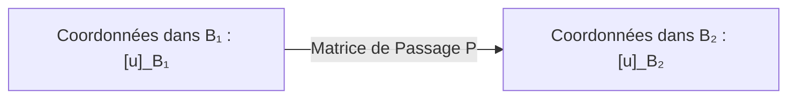
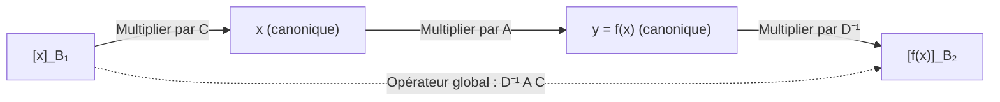
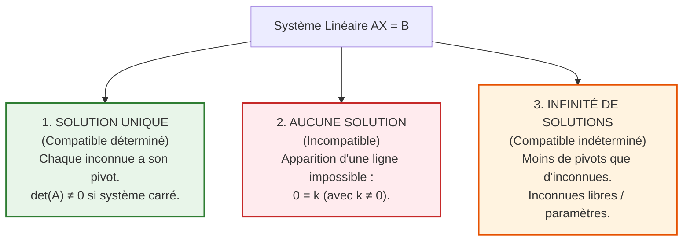

# 📘 Chapitre 5 : Applications du Calcul Matriciel
### *Cours d'Algèbre Linéaire et Calcul Matriciel — Business Analyst (ICHEC)*

---

## 🧒 1. L'Intuition pour un Enfant : Le Traducteur Universel et le Détective

Dans ce chapitre, nous allons récolter tous les fruits des chapitres précédents !
Nous avons deux missions passionnantes :

1. **Le Traducteur Universel (Le Changement de Base) :**
   Imagine que deux personnes décrivent la position de la même maison :
   - Alice utilise des pas vers le Nord et vers l'Est (la base habituelle).
   - Bob utilise des pas en diagonale vers la colline et vers la rivière (une autre base).
   La maison est exactement au même endroit physique, mais **les chiffres qu'Alice et Bob utilisent sont complètement différents**. 
   Comment traduire les coordonnées de Bob dans le langage d'Alice en une seule multiplication ? Grâce à la **matrice de passage** !
2. **Le Détective des Équations (Le Pivot de Gauss) :**
   Imagine une énigme policière avec 3 suspects et 3 indices contradictoires.
   Le **Pivot de Gauss**, c'est une méthode infaillible de détective : on élimine les inconnues une par une pour remonter jusqu'à la vérité. Trois destins sont possibles :
   - Soit il y a **un seul coupable certain** (solution unique),
   - Soit l'histoire est absurde et impossible (aucune solution),
   - Soit il y a **toute une bande complice** (infinité de solutions).

---

## 🎯 2. Application 1 : Reconnaître une Base en 3 Secondes avec le Déterminant

Au Chapitre 1, pour prouver qu'une famille de $n$ vecteurs était une base de $\mathbb{R}^n$, il fallait résoudre de longs systèmes d'équations pour tester si elle était libre.
Grâce au déterminant, **c'est maintenant plié en un seul calcul** !

### A. Le Théorème Fondamental
Soit une famille de $n$ vecteurs dans $\mathbb{R}^n$ : $\mathcal{B} = (\mathbf{v}_1, \mathbf{v}_2, \dots, \mathbf{v}_n)$.
Formons la matrice carrée $A$ dont les **colonnes** sont ces $n$ vecteurs :
$$
A = \begin{pmatrix} 
\mid & \mid & & \mid \\
\mathbf{v}_1 & \mathbf{v}_2 & \cdots & \mathbf{v}_n \\
\mid & \mid & & \mid 
\end{pmatrix}
$$

> [!IMPORTANT]
> **Théorème de la Base :**
> $$\mathbf{(\mathbf{v}_1, \dots, \mathbf{v}_n) \text{ forme une BASE de } \mathbb{R}^n \iff \det(A) \neq 0}$$
> - Si $\det(A) \neq 0$ : les vecteurs ne sont pas coplanaires/colinéaires, ils n'écrasent pas l'espace $\implies$ **C'est une base** !
> - Si $\det(A) = 0$ : les vecteurs sont liés (redondants) $\implies$ **Ce n'est pas une base**.

---

### B. Exemples Détaillés (Slides 7-8)

#### Exemple 1 : Une famille qui n'est pas une base
Dans $\mathbb{R}^2$, considérons $\mathbf{v}_1 = \begin{pmatrix} 1 \\ -2 \end{pmatrix}$ et $\mathbf{v}_2 = \begin{pmatrix} -2 \\ 4 \end{pmatrix}$.
Formons la matrice et calculons son déterminant :
$$
\det \begin{pmatrix} 1 & -2 \\ -2 & 4 \end{pmatrix} = (1 \times 4) - (-2 \times -2) = 4 - 4 = \mathbf{0}
$$
Puisque le déterminant est nul, la famille $(\mathbf{v}_1, \mathbf{v}_2)$ n'est pas libre : **ce n'est pas une base de $\mathbb{R}^2$**.
*(Remarque : on voit immédiatement que $\mathbf{v}_2 = -2 \mathbf{v}_1$).*

#### Exemple 2 : Une famille qui forme une base
Dans $\mathbb{R}^2$, considérons $\mathbf{v}_1 = \begin{pmatrix} 2 \\ 1 \end{pmatrix}$ et $\mathbf{v}_2 = \begin{pmatrix} -3 \\ 2 \end{pmatrix}$.
$$
\det \begin{pmatrix} 2 & -3 \\ 1 & 2 \end{pmatrix} = (2 \times 2) - (-3 \times 1) = 4 - (-3) = \mathbf{7} \neq 0
$$
Puisque le déterminant est non nul, la famille $(\mathbf{v}_1, \mathbf{v}_2)$ est libre : **c'est une base de $\mathbb{R}^2$** !

---

## 🔄 3. Application 2 : Tester la Bijectivité d'une Application Linéaire

Soit un endomorphisme $f : \mathbb{R}^n \to \mathbb{R}^n$ (espace de départ et d'arrivée de même dimension $n$), représenté par sa matrice carrée $A$.

> [!TIP]
> **Caractérisation de la Bijectivité :**
> $$\mathbf{f \text{ est BIJECTIVE} \iff A \text{ est INVERSIBLE} \iff \det(A) \neq 0}$$
> Si $\det(A) \neq 0$, $f$ est automatiquement **injective**, **surjective** et **bijective** !
> L'application réciproque $f^{-1}$ a tout simplement pour matrice $A^{-1}$.

---

## 🗺️ 4. Application 3 : Les Changements de Base

### A. La Matrice de Passage : Qu'est-ce que c'est ?
Soient $\mathcal{B}_1$ et $\mathcal{B}_2$ deux bases de $\mathbb{R}^n$.
La **matrice de passage de $\mathcal{B}_1$ vers $\mathcal{B}_2$**, notée $P$, est l'opérateur qui convertit directement les coordonnées d'un vecteur exprimé dans la base $\mathcal{B}_1$ en ses coordonnées dans la base $\mathcal{B}_2$ :
$$
\mathbf{[\mathbf{u}]_{\mathcal{B}_2} = P [\mathbf{u}]_{\mathcal{B}_1}}
$$

---

### B. Les Deux Règles Fondamentales pour Construire $P$ (Convention ICHEC - Prof. Bui)

Soit $\mathcal{B}_{\text{can}}$ la base canonique de $\mathbb{R}^n$.

#### Règle 1 : Si la base d'arrivée est la base canonique (Slide 19)
Pour passer d'une base quelconque $\mathcal{B}_1 = (\mathbf{b}_1, \dots, \mathbf{b}_n)$ vers la base canonique $\mathcal{B}_{\text{can}}$ :
La matrice de passage est tout simplement la matrice $C$ dont les **colonnes sont les vecteurs de $\mathcal{B}_1$** :
$$
C = \begin{pmatrix} 
\mid & \mid & & \mid \\
\mathbf{b}_1 & \mathbf{b}_2 & \cdots & \mathbf{b}_n \\
\mid & \mid & & \mid 
\end{pmatrix} \quad \implies \quad [\mathbf{u}]_{\text{can}} = C [\mathbf{u}]_{\mathcal{B}_1}
$$

#### Règle 2 : Si la base de départ est la base canonique (Slide 20)
Pour passer de la base canonique $\mathcal{B}_{\text{can}}$ vers une base quelconque $\mathcal{B}_2 = (\mathbf{b}'_1, \dots, \mathbf{b}'_n)$ :
La matrice de passage est **l'INVERSE** de la matrice dont les colonnes sont les vecteurs de $\mathcal{B}_2$ :
$$
D = \begin{pmatrix} 
\mid & \mid & & \mid \\
\mathbf{b}'_1 & \mathbf{b}'_2 & \cdots & \mathbf{b}'_n \\
\mid & \mid & & \mid 
\end{pmatrix} \quad \implies \quad [\mathbf{u}]_{\mathcal{B}_2} = D^{-1} [\mathbf{u}]_{\text{can}}
$$

#### Règle 3 : Pour passer d'une base quelconque $\mathcal{B}_1$ à une base quelconque $\mathcal{B}_2$ :
On fait une escale par la base canonique : $\mathcal{B}_1 \xrightarrow{\; C \;} \mathcal{B}_{\text{can}} \xrightarrow{\; D^{-1} \;} \mathcal{B}_2$ :
$$
\mathbf{P = D^{-1} C}
$$

---

### C. Exemple Numérique Complet de Matrice de Passage (Slides 16-18)

Dans $\mathbb{R}^2$, considérons :
$$
\mathcal{B}_1 = \left( \begin{pmatrix} 3 \\ -4 \end{pmatrix}, \begin{pmatrix} 1 \\ 1 \end{pmatrix} \right) \quad \text{et} \quad \mathcal{B}_2 = \left( \begin{pmatrix} 1 \\ -2 \end{pmatrix}, \begin{pmatrix} -1 \\ 3 \end{pmatrix} \right)
$$
1. Matrice des vecteurs de $\mathcal{B}_1$ : $C = \begin{pmatrix} 3 & 1 \\ -4 & 1 \end{pmatrix}$.
2. Matrice des vecteurs de $\mathcal{B}_2$ : $D = \begin{pmatrix} 1 & -1 \\ -2 & 3 \end{pmatrix}$.
3. Calcul de $D^{-1}$ :
   $\det(D) = 1(3) - (-1)(-2) = 3 - 2 = 1$.
   $$D^{-1} = \frac{1}{1} \begin{pmatrix} 3 & 1 \\ 2 & 1 \end{pmatrix} = \begin{pmatrix} 3 & 1 \\ 2 & 1 \end{pmatrix}$$
4. Matrice de passage de $\mathcal{B}_1$ vers $\mathcal{B}_2$ :
   $$
   P = D^{-1} C = \begin{pmatrix} 3 & 1 \\ 2 & 1 \end{pmatrix} \begin{pmatrix} 3 & 1 \\ -4 & 1 \end{pmatrix} = \begin{pmatrix} 3(3)+1(-4) & 3(1)+1(1) \\ 2(3)+1(-4) & 2(1)+1(1) \end{pmatrix} = \mathbf{\begin{pmatrix} 5 & 4 \\ 2 & 3 \end{pmatrix}}
   $$

#### Vérification sur un vecteur particulier :
Soit $[\mathbf{u}]_{\mathcal{B}_1} = \begin{pmatrix} 2 \\ -3 \end{pmatrix}$.
Calculons $[\mathbf{u}]_{\mathcal{B}_2}$ avec la formule :
$$
[\mathbf{u}]_{\mathcal{B}_2} = P [\mathbf{u}]_{\mathcal{B}_1} = \begin{pmatrix} 5 & 4 \\ 2 & 3 \end{pmatrix} \begin{pmatrix} 2 \\ -3 \end{pmatrix} = \begin{pmatrix} 5(2)+4(-3) \\ 2(2)+3(-3) \end{pmatrix} = \begin{pmatrix} -2 \\ -5 \end{pmatrix}
$$
- Dans $\mathcal{B}_1$ : $\mathbf{u} = 2 \begin{pmatrix} 3 \\ -4 \end{pmatrix} - 3 \begin{pmatrix} 1 \\ 1 \end{pmatrix} = \begin{pmatrix} 6 - 3 \\ -8 - 3 \end{pmatrix} = \begin{pmatrix} 3 \\ -11 \end{pmatrix}$.
- Dans $\mathcal{B}_2$ : $\mathbf{u} = -2 \begin{pmatrix} 1 \\ -2 \end{pmatrix} - 5 \begin{pmatrix} -1 \\ 3 \end{pmatrix} = \begin{pmatrix} -2 + 5 \\ 4 - 15 \end{pmatrix} = \begin{pmatrix} 3 \\ -11 \end{pmatrix}$.
Les deux expressions redonnent **rigoureusement le même vecteur dans l'espace** !

---

### D. Changement de Base pour une Application Linéaire (Formule $D^{-1}AC$)

Soit une application linéaire $f : \mathbb{R}^n \to \mathbb{R}^m$, et soit $A$ sa matrice dans les bases canoniques.
Si l'on choisit une base $\mathcal{B}_1$ pour le départ et une base $\mathcal{B}_2$ pour l'arrivée :
- Soit $C$ la matrice formée par les colonnes de $\mathcal{B}_1$.
- Soit $D$ la matrice formée par les colonnes de $\mathcal{B}_2$.

La matrice de $f$ par rapport à ces nouvelles bases est :
$$
\mathbf{[f]_{\mathcal{B}_2 \leftarrow \mathcal{B}_1} = D^{-1} A C}
$$

*(Dans le cas particulier où $f$ est un endomorphisme de $\mathbb{R}^n \to \mathbb{R}^n$ et qu'on utilise la même base $\mathcal{B}$ au départ et à l'arrivée, avec $C = D = P$, la formule devient la célèbre formule de conjugaison : $A' = P^{-1} A P$ !)*

---

## 📐 5. Application 4 : Résolution des Systèmes d'Équations Linéaires

### A. Écriture Matricielle d'un Système
Un système de $m$ équations à $n$ inconnues :
$$
\begin{cases}
a_{11} x_1 + a_{12} x_2 + \dots + a_{1n} x_n = b_1 \\
a_{21} x_1 + a_{22} x_2 + \dots + a_{2n} x_n = b_2 \\
\vdots \\
a_{m1} x_1 + a_{m2} x_2 + \dots + a_{mn} x_n = b_m
\end{cases}
$$
s'écrit sous forme condensée :
$$
\mathbf{A X = B}
$$
où $A \in \mathbb{R}^{m \times n}$ est la matrice des coefficients, $X = \begin{pmatrix} x_1 \\ \vdots \\ x_n \end{pmatrix}$ est le vecteur des inconnues, et $B = \begin{pmatrix} b_1 \\ \vdots \\ b_m \end{pmatrix}$ est le second membre.

---

### B. Le Pivot de Gauss : Rendre le Système Échelonné
On travaille sur la **matrice augmentée** $(A \mid B)$.
Un système est dit **échelonné** si le nombre de zéros au début de chaque ligne augmente strictement à chaque ligne descendante :
$$
\left(\begin{array}{ccc|c} 
\mathbf{1} & * & * & * \\ 
0 & \mathbf{3} & * & * \\ 
0 & 0 & \mathbf{5} & * 
\end{array}\right)
$$
Les premiers coefficients non nuls de chaque ligne sont appelés les **pivots**.

---

### C. Les 3 Comportements Possibles d'un Système Linéaire (Slides 31-34)

Tout système linéaire dans le monde possède **strictement l'un des 3 destins suivants** :

#### Exemple 1 : Solution Unique (Slide 31)
$$
\begin{cases}
x + y + z = 6 \\
2x + 3y + z = 11 \\
x + 2y + 3z = 14
\end{cases}
$$
- Opérations : $L_2 \leftarrow L_2 - 2L_1$ et $L_3 \leftarrow L_3 - L_1$ :
  $$
  \begin{cases} x + y + z = 6 \\ y - z = -1 \\ y + 2z = 8 \end{cases}
  $$
- Opération : $L_3 \leftarrow L_3 - L_2$ :
  $$
  \begin{cases} x + y + z = 6 \\ y - z = -1 \\ 3z = 9 \end{cases}
  $$
- Remontée par substitution :
  $3z = 9 \implies \mathbf{z = 3}$.
  $y - 3 = -1 \implies \mathbf{y = 2}$.
  $x + 2 + 3 = 6 \implies \mathbf{x = 1}$.
- **Solution unique :** $S = \left\{ \begin{pmatrix} 1 \\ 2 \\ 3 \end{pmatrix} \right\}$.

---

#### Exemple 2 : Aucune Solution (Système Incompatible, Slide 32)
$$
\begin{cases}
x + y + z = 3 \\
2x + 3y + z = 7 \\
3x + 5y + z = 13
\end{cases}
$$
- $L_2 \leftarrow L_2 - 2L_1$ et $L_3 \leftarrow L_3 - 3L_1$ :
  $$
  \begin{cases} x + y + z = 3 \\ y - z = 1 \\ 2y - 2z = 4 \end{cases}
  $$
- $L_3 \leftarrow L_3 - 2L_2$ :
  $$
  \begin{cases} x + y + z = 3 \\ y - z = 1 \\ \mathbf{0 = 2} \end{cases}
  $$
- L'équation $0 = 2$ est une contradiction impossible !
- **Conclusion :** Le système n'a aucune solution : $S = \emptyset$.

---

#### Exemple 3 : Infinité de Solutions (Slide 33)
$$
\begin{cases}
x + y + z = 6 \\
2x + 3y + z = 11 \\
3x + 4y + 2z = 17
\end{cases}
$$
- $L_2 \leftarrow L_2 - 2L_1$ et $L_3 \leftarrow L_3 - 3L_1$ :
  $$
  \begin{cases} x + y + z = 6 \\ y - z = -1 \\ y - z = -1 \end{cases}
  $$
- $L_3 \leftarrow L_3 - L_2$ :
  $$
  \begin{cases} x + y + z = 6 \\ y - z = -1 \\ \mathbf{0 = 0} \end{cases}
  $$
- La dernière ligne s'évapore ($0 = 0$). Il y a 2 pivots pour 3 inconnues. L'inconnue $z$ est **libre** (paramètre réel) :
  $y = z - 1$
  $x = 6 - y - z = 6 - (z - 1) - z = 7 - 2z$.
- **Ensemble des solutions (une droite affine) :**
  $$
  S = \left\{ \begin{pmatrix} 7 - 2z \\ z - 1 \\ z \end{pmatrix} \;\middle|\; z \in \mathbb{R} \right\} = \left\{ \begin{pmatrix} 7 \\ -1 \\ 0 \end{pmatrix} + z \begin{pmatrix} -2 \\ 1 \\ 1 \end{pmatrix} \;\middle|\; z \in \mathbb{R} \right\}
  $$

---

### D. Résolution Directe des Systèmes Carrés par la Matrice Inverse ($X = A^{-1} B$)

Si le système a **autant d'équations que d'inconnues** ($n \times n$) et que $\det(A) \neq 0$, alors $A$ est inversible et la solution unique se calcule directement en multipliant à gauche par $A^{-1}$ :
$$
A X = B \implies A^{-1} A X = A^{-1} B \implies \mathbf{X = A^{-1} B}
$$

#### Exemple d'Examen Résolu Pas à Pas (Slides 36-37) :
$$
\begin{cases}
2x + y + 3z = 3 \\
x + y + 2z = 3 \\
3x - y + z = -4
\end{cases}
\iff
\underbrace{\begin{pmatrix} 2 & 1 & 3 \\ 1 & 1 & 2 \\ 3 & -1 & 1 \end{pmatrix}}_{A} \begin{pmatrix} x \\ y \\ z \end{pmatrix} = \underbrace{\begin{pmatrix} 3 \\ 3 \\ -4 \end{pmatrix}}_{B}
$$
1. On calcule le déterminant : $\det(A) = -1 \neq 0 \implies$ la matrice est inversible !
2. On calcule son inverse (par Gauss ou comatrice) :
   $$
   A^{-1} = \begin{pmatrix} -3 & 4 & 1 \\ -5 & 7 & 1 \\ 4 & -5 & -1 \end{pmatrix}
   $$
3. On calcule directement le vecteur solution $X$ :
   $$
   X = A^{-1} B = \begin{pmatrix} -3 & 4 & 1 \\ -5 & 7 & 1 \\ 4 & -5 & -1 \end{pmatrix} \begin{pmatrix} 3 \\ 3 \\ -4 \end{pmatrix} = \begin{pmatrix} -3(3) + 4(3) + 1(-4) \\ -5(3) + 7(3) + 1(-4) \\ 4(3) - 5(3) - 1(-4) \end{pmatrix} = \begin{pmatrix} -9 + 12 - 4 \\ -15 + 21 - 4 \\ 12 - 15 + 4 \end{pmatrix} = \mathbf{\begin{pmatrix} -1 \\ 2 \\ 1 \end{pmatrix}}
   $$
La solution unique est donc $x = -1, y = 2, z = 1$.

---

## 🗣️ 6. Le Guide de l'Oral : Comment décrire ces calculs à l'examen

- **Pour justifier qu'une famille est une base :**
  > *"Je place les vecteurs en colonnes dans une matrice carrée $A$. Le déterminant de cette matrice étant strictement non nul, les vecteurs sont linéairement indépendants. Comme leur nombre est égal à la dimension de l'espace, la famille constitue une base."*
- **Pour décrire le changement de base d'une application linéaire :**
  > *"Pour calculer $[f]_{\mathcal{B}_2 \leftarrow \mathcal{B}_1}$, j'utilise la formule $D^{-1}AC$. La matrice $C$ traduit les coordonnées de la base de départ $\mathcal{B}_1$ vers la base canonique, la matrice $A$ applique la transformation dans les bases canoniques, et la matrice $D^{-1}$ convertit le résultat vers la base d'arrivée $\mathcal{B}_2$."*
- **Pour analyser la compatibilité d'un système linéaire :**
  > *"J'applique les opérations élémentaires de lignes du pivot de Gauss pour échelonner la matrice augmentée. Si aucune contradiction de type $0 = k$ n'apparaît et que chaque variable possède un pivot, le système est compatible déterminé et admet une solution unique."*

---

## 📌 7. À Retenir Absolument (Points Clés du Chapitre 5)

1. Base de $\mathbb{R}^n$ $\iff \det(v_1, \dots, v_n) \neq 0$.
2. Application linéaire bijective $\iff \det(A) \neq 0$.
3. Matrice de passage : $[\mathbf{u}]_{\mathcal{B}_2} = P [\mathbf{u}]_{\mathcal{B}_1}$, avec $P = D^{-1} C$.
4. Matrice d'application linéaire dans de nouvelles bases : $[f]_{\mathcal{B}_2 \leftarrow \mathcal{B}_1} = D^{-1} A C$.
5. Résolution de systèmes : Pivot de Gauss sur $(A \mid B)$.
6. 3 destins : Solution unique ($n$ pivots), Aucune solution (ligne $0 = k$), Infinité de solutions (variables libres).
7. Si $\det(A) \neq 0$, la solution unique est donnée par $X = A^{-1} B$.

---

➡️ **Passer au chapitre suivant :** [Chapitre 6 : Diagonalisation et Systèmes Dynamiques](file:///c:/Users/cemmi/OneDrive%20-%20ICHEC/Math/Alg%C3%A8bre/Guides_de_Cours_Complets/Chapitre_6_Diagonalisation_et_Applications.md)
